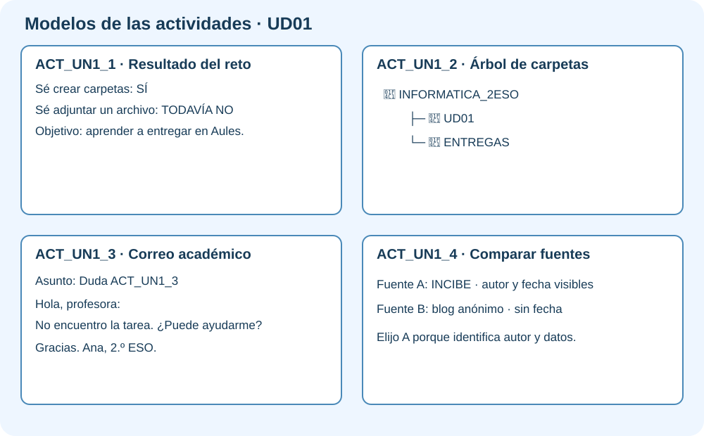

# Actividades · Introducción al uso del ordenador

Estas actividades preparan el primer proyecto: crear y mantener ordenada la carpeta de la **Feria Digital Responsable**.

Trabaja en **LliureX**, con los menús en español. Lee **un paso cada vez** y comprueba el resultado antes de seguir. Las actividades de texto usan **LibreOffice Writer**; las hojas de cálculo, **Calc**; las presentaciones, **Impress**. Cada actividad concreta su herramienta y sus archivos de entrega.

| Código en Aules | Actividad |
|---|---|
| ACT_UN1_1 | Reto inicial sobre conocimientos de cursos anteriores |
| ACT_UN1_2 | Crear y ordenar el árbol de carpetas del curso |
| ACT_UN1_3 | Redactar y responder un correo académico |
| ACT_UN1_4 | Comparar dos fuentes sobre identidad digital |

## ACT_UN1_1 · Reto inicial sobre conocimientos de cursos anteriores

### ¿Qué vas a hacer?

Escribir cinco respuestas sobre tus hábitos digitales y reconocer qué sabes hacer sin ayuda.

**Herramienta:** LibreOffice Writer.

**Dónde guardar:** `Documentos/FERIA_DIGITAL_TUNOMBRE/UD01_ORGANIZACION/ACTIVIDADES`. Si falta alguna carpeta, abre el **Gestor de archivos → Documentos**, entra en la carpeta anterior y créala con **clic derecho → Crear carpeta**. Cambia `TUNOMBRE` por tu nombre de aula.

!!! example "Ejemplo de resultado"
    Documento con cinco respuestas y una marca final: **solo / con ayuda / todavía no**.

### Pasos

1. Abre **Menú de aplicaciones → Oficina → LibreOffice Writer**. Pulsa **Archivo → Nuevo → Documento de texto**.
2. Escribe `Así utilizo la tecnología` y pulsa **Intro**. Selecciona el título con el ratón y pulsa el botón **Negrita** de la barra superior.
3. Debajo escribe estas cinco preguntas, una por párrafo: `¿Qué dispositivo uso?`, `¿Para qué lo uso?`, `¿Dónde guardo mis archivos?`, `¿Qué hago si olvido una contraseña?` y `¿Cómo compruebo una noticia?`.
4. Después de cada pregunta escribe una respuesta de una o dos frases. Explica tus hábitos sin escribir contraseñas, direcciones ni teléfonos.
5. Añade `Lo he realizado:` y una opción: `solo`, `con un poco de ayuda` o `con mucha ayuda`.
6. Pulsa **Herramientas → Ortografía**. Lee cada propuesta antes de aceptarla. Comprueba que hay cinco respuestas y una valoración final.
7. Pulsa **Archivo → Guardar como**. Abre tu carpeta de esta unidad, escribe `ACT_UN1_1_ApellidoNombre_v01.odt` y conserva el formato OpenDocument correspondiente. Sustituye `ApellidoNombre` por tu apellido y nombre. Pulsa **Guardar** y, si pregunta el formato, elige **Usar formato OpenDocument**.
8. Para crear el PDF, pulsa **Archivo → Exportar como → Exportar como PDF → Exportar**, escribe el mismo nombre del editable y pulsa **Guardar**. Abre el PDF desde el Gestor de archivos y comprueba que no hay texto cortado.
9. Abre **Firefox**, entra en Aules con tu cuenta del centro y abre **Informática → UD01 → ACT_UN1_1**. Pulsa **Agregar entrega** (o **Editar entrega** si ya existe), arrastra los archivos pedidos al recuadro y pulsa **Guardar cambios**. Si aparece **Enviar tarea**, púlsalo y confirma. Comprueba que se ven tus archivos y que la entrega figura enviada.

### ¿Qué debes entregar?

- `ACT_UN1_1_ApellidoNombre_v01.odt`
- `ACT_UN1_1_ApellidoNombre_v01.pdf`
- Si utilizaste IA, indica la herramienta, para qué la usaste y cómo revisaste el resultado. Si no la usaste, indícalo sin inventar consultas.

### Antes de enviar

- [ ] Hay cinco respuestas y una autoevaluación.
- [ ] He abierto el archivo guardado y se ve completo.
- [ ] Los archivos tienen el nombre pedido y están adjuntos en Aules.
- [ ] No incluyo contraseñas, direcciones, teléfonos ni datos de otras personas.

## ACT_UN1_2 · Crear y ordenar el árbol de carpetas del curso

### ¿Qué vas a hacer?

Crear las carpetas de trabajo de la primera unidad y mostrar su organización en una captura.

**Herramienta:** Gestor de archivos de LliureX y Captura de pantalla.

**Dónde guardar:** `Documentos/INFORMATICA/UD01/ENTREGAS`. Si falta alguna carpeta, abre el **Gestor de archivos → Documentos**, entra en la carpeta anterior y créala con **clic derecho → Crear carpeta**. Cambia `TUNOMBRE` por tu nombre de aula.

!!! example "Ejemplo de resultado"
    `INFORMATICA/UD01/ACTIVIDADES`, `RECURSOS` y `ENTREGAS`, visibles en una misma captura.

### Pasos

1. Abre **Menú de aplicaciones** y busca **Gestor de archivos**. En la columna izquierda pulsa **Documentos**.
2. Haz clic derecho en una zona vacía, elige **Crear carpeta**, escribe `INFORMATICA` y pulsa **Crear**. Si ya existe, ábrela con doble clic.
3. Dentro de `INFORMATICA`, crea `UD01`. Abre `UD01` y crea tres carpetas: `ACTIVIDADES`, `RECURSOS` y `ENTREGAS`.
4. En el Gestor de archivos activa la vista de árbol del panel lateral si está disponible y despliega `INFORMATICA` y `UD01`. Si no aparece, deja abierta `UD01` para que se vean las tres carpetas y la ruta superior.
5. Abre **Menú de aplicaciones → Captura de pantalla**. Elige capturar la ventana del Gestor de archivos y pulsa **Tomar captura**. Si la aplicación no permite elegir ventana, captura la pantalla completa con esa ventana delante.
6. Guarda la imagen en `Documentos/INFORMATICA/UD01/ENTREGAS` con el nombre `ACT_UN1_2_ApellidoNombre_v01.png`. Ábrela con doble clic y comprueba que se leen los tres nombres.
7. Abre **Firefox**, entra en Aules con tu cuenta del centro y abre **Informática → UD01 → ACT_UN1_2**. Pulsa **Agregar entrega** (o **Editar entrega** si ya existe), arrastra los archivos pedidos al recuadro y pulsa **Guardar cambios**. Si aparece **Enviar tarea**, púlsalo y confirma. Comprueba que se ven tus archivos y que la entrega figura enviada.

### ¿Qué debes entregar?

- `ACT_UN1_2_ApellidoNombre_v01.png`
- Si utilizaste IA, indica la herramienta, para qué la usaste y cómo revisaste el resultado. Si no la usaste, indícalo sin inventar consultas.

### Antes de enviar

- [ ] La captura muestra UD01 y sus tres subcarpetas.
- [ ] He abierto el archivo guardado y se ve completo.
- [ ] Los archivos tienen el nombre pedido y están adjuntos en Aules.
- [ ] No incluyo contraseñas, direcciones, teléfonos ni datos de otras personas.

## ACT_UN1_3 · Redactar y responder un correo académico

### ¿Qué vas a hacer?

Preparar un correo académico, responder a otro mensaje y documentar ambos ejercicios.

**Herramienta:** Firefox, correo educativo de Microsoft Outlook y LibreOffice Writer.

**Dónde guardar:** `Documentos/FERIA_DIGITAL_TUNOMBRE/UD01_ORGANIZACION/ACTIVIDADES`. Si falta alguna carpeta, abre el **Gestor de archivos → Documentos**, entra en la carpeta anterior y créala con **clic derecho → Crear carpeta**. Cambia `TUNOMBRE` por tu nombre de aula.

!!! example "Ejemplo de resultado"
    **Asunto:** Duda ACT_UN1_3. **Mensaje:** «Buenos días. No encuentro la tarea de la UD1. ¿Podría indicarme dónde está? Gracias. Un saludo, Ana 2.ºB».

### Pasos

1. Abre **Firefox** y entra en [Outlook educativo](https://outlook.office.com/). Inicia sesión con la cuenta educativa del centro. Si no puedes acceder, realiza la simulación en Writer que se explica en el paso 6; no necesitas una cuenta personal.
2. En Outlook pulsa **Correo nuevo**. En **Para**, escribe solo la dirección que el profesor haya facilitado en clase. No inventes un destinatario.
3. En **Asunto** escribe `Duda sobre ACT_UN1_3`. Redacta un saludo, una pregunta concreta sobre la actividad, un agradecimiento y una despedida. Déjalo como borrador; envíalo cuando el profesor dé la indicación.
4. Si el profesor te ha enviado un mensaje de práctica, ábrelo y pulsa **Responder**. Escribe una respuesta que conteste a su pregunta. Revísala antes del envío indicado en clase.
5. Abre **Menú de aplicaciones → Oficina → LibreOffice Writer**. Pulsa **Archivo → Nuevo → Documento de texto**.
6. Escribe `Correo inicial` y copia asunto y cuerpo del borrador. Debajo escribe `Respuesta` y copia tu contestación. Si no hay acceso al correo o no has recibido un mensaje, usa esta simulación: `Mensaje recibido: ¿Has podido abrir la actividad? Indica si necesitas ayuda.` Redacta tu respuesta debajo.
7. No copies direcciones de correo ni la lista de contactos al documento. Añade una frase: `He comprobado el asunto, el saludo y la pregunta`.
8. Pulsa **Archivo → Guardar como**. Abre tu carpeta de esta unidad, escribe `ACT_UN1_3_ApellidoNombre_v01.odt` y conserva el formato OpenDocument correspondiente. Sustituye `ApellidoNombre` por tu apellido y nombre. Pulsa **Guardar** y, si pregunta el formato, elige **Usar formato OpenDocument**.
9. Para crear el PDF, pulsa **Archivo → Exportar como → Exportar como PDF → Exportar**, escribe el mismo nombre del editable y pulsa **Guardar**. Abre el PDF desde el Gestor de archivos y comprueba que no hay texto cortado.
10. Abre **Firefox**, entra en Aules con tu cuenta del centro y abre **Informática → UD01 → ACT_UN1_3**. Pulsa **Agregar entrega** (o **Editar entrega** si ya existe), arrastra los archivos pedidos al recuadro y pulsa **Guardar cambios**. Si aparece **Enviar tarea**, púlsalo y confirma. Comprueba que se ven tus archivos y que la entrega figura enviada.

### ¿Qué debes entregar?

- `ACT_UN1_3_ApellidoNombre_v01.odt`
- `ACT_UN1_3_ApellidoNombre_v01.pdf`
- Si utilizaste IA, indica la herramienta, para qué la usaste y cómo revisaste el resultado. Si no la usaste, indícalo sin inventar consultas.

### Antes de enviar

- [ ] Incluyo el correo inicial y una respuesta.
- [ ] He abierto el archivo guardado y se ve completo.
- [ ] Los archivos tienen el nombre pedido y están adjuntos en Aules.
- [ ] No incluyo contraseñas, direcciones, teléfonos ni datos de otras personas.

## ACT_UN1_4 · Comparar dos fuentes sobre identidad digital

### ¿Qué vas a hacer?

Comparar dos fuentes sobre la huella digital y justificar cuál ofrece más garantías.

**Herramienta:** Firefox y LibreOffice Writer.

**Dónde guardar:** `Documentos/FERIA_DIGITAL_TUNOMBRE/UD01_ORGANIZACION/ACTIVIDADES`. Si falta alguna carpeta, abre el **Gestor de archivos → Documentos**, entra en la carpeta anterior y créala con **clic derecho → Crear carpeta**. Cambia `TUNOMBRE` por tu nombre de aula.

!!! example "Ejemplo de resultado"
    Tabla con `Fuente A: organismo público, autor y fecha visibles` y `Fuente B: sin autor ni fecha`; conclusión: «La fuente A ofrece más garantías».

### Pasos

1. Abre **Menú de aplicaciones → Oficina → LibreOffice Writer**. Pulsa **Archivo → Nuevo → Documento de texto**.
2. Escribe el título `¿Qué es la huella digital y cómo puedo cuidarla?`. Pulsa **Intro**.
3. Pulsa **Tabla → Insertar tabla**. Crea **4 columnas y 3 filas**. En la primera fila escribe `Fuente`, `Autor y fecha`, `Qué explica` y `Enlace`.
4. Abre **Firefox**. Busca `huella digital INCIBE menores` y abre un resultado del dominio `incibe.es`. Lee el texto y copia su dirección desde la barra superior.
5. En la segunda fila de Writer anota el título de la página, la organización, la fecha visible y dos ideas con tus palabras. Si no hay fecha, escribe `sin fecha visible`.
6. En Firefox busca `huella digital AEPD` y abre una página de `aepd.es`. Completa la tercera fila con sus datos y enlace.
7. Debajo de la tabla escribe tres frases: una coincidencia entre las fuentes, una diferencia y cuál te resulta más útil. Justifica tu elección usando autoría, fecha o explicación; no basta con decir que te gusta más.
8. Pulsa **Archivo → Guardar como**. Abre tu carpeta de esta unidad, escribe `ACT_UN1_4_ApellidoNombre_v01.odt` y conserva el formato OpenDocument correspondiente. Sustituye `ApellidoNombre` por tu apellido y nombre. Pulsa **Guardar** y, si pregunta el formato, elige **Usar formato OpenDocument**.
9. Para crear el PDF, pulsa **Archivo → Exportar como → Exportar como PDF → Exportar**, escribe el mismo nombre del editable y pulsa **Guardar**. Abre el PDF desde el Gestor de archivos y comprueba que no hay texto cortado.
10. Abre **Firefox**, entra en Aules con tu cuenta del centro y abre **Informática → UD01 → ACT_UN1_4**. Pulsa **Agregar entrega** (o **Editar entrega** si ya existe), arrastra los archivos pedidos al recuadro y pulsa **Guardar cambios**. Si aparece **Enviar tarea**, púlsalo y confirma. Comprueba que se ven tus archivos y que la entrega figura enviada.

### ¿Qué debes entregar?

- `ACT_UN1_4_ApellidoNombre_v01.odt`
- `ACT_UN1_4_ApellidoNombre_v01.pdf`
- Si utilizaste IA, indica la herramienta, para qué la usaste y cómo revisaste el resultado. Si no la usaste, indícalo sin inventar consultas.

### Antes de enviar

- [ ] Hay dos enlaces y una conclusión justificada.
- [ ] He abierto el archivo guardado y se ve completo.
- [ ] Los archivos tienen el nombre pedido y están adjuntos en Aules.
- [ ] No incluyo contraseñas, direcciones, teléfonos ni datos de otras personas.

!!! info "Mecanografía"
    Una vez por semana se dedicarán entre cinco y diez minutos a mecanografía en forma de juego. Abre **Firefox** y el enlace de mecanografía que figura en la sección de tu curso en Aules. Solo se entrega si el profesor lo indica.
