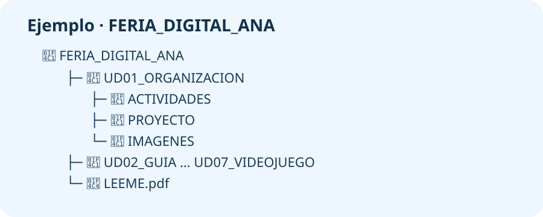

# PROY_UN1 · Preparamos nuestro espacio de trabajo

## El proyecto del curso

Durante el curso prepararemos materiales para una **Feria Digital Responsable**. En cada unidad crearás una parte. En esta primera etapa vas a ordenar el espacio donde guardarás todo el proyecto.

## ¿Qué tienes que hacer?

Crea una carpeta principal llamada `FERIA_DIGITAL_TUNOMBRE`. Dentro debe haber una carpeta para cada unidad y un documento que explique la organización. Otra persona debe poder encontrar un archivo sin preguntarte.

!!! example "Ejemplo terminado"
    Dentro de `FERIA_DIGITAL_ANA` aparecen `UD01_ORGANIZACION`, `UD02_GUIA`, `UD03_PRESUPUESTO`, `UD04_PRESENTACION`, `UD05_IA`, `UD06_DECALOGO` y `UD07_VIDEOJUEGO`. También aparece `LEEME.pdf`.

## Pasos

1. Abre **Menú de aplicaciones → Gestor de archivos**. Pulsa **Documentos** en la columna izquierda. Haz clic derecho en una zona vacía → **Crear carpeta**, escribe `FERIA_DIGITAL_TUNOMBRE` y confirma. Sustituye TUNOMBRE por tu nombre de aula; si ya la creaste durante las actividades, ábrela.
2. Dentro crea estas siete carpetas con **clic derecho → Crear carpeta**: `UD01_ORGANIZACION`, `UD02_GUIA`, `UD03_PRESUPUESTO`, `UD04_PRESENTACION`, `UD05_IA`, `UD06_DECALOGO` y `UD07_VIDEOJUEGO`.
3. Abre `UD01_ORGANIZACION` y crea `ACTIVIDADES`, `PROYECTO` e `IMAGENES`. Vuelve a la carpeta principal con el botón de retroceso.
4. Abre **Menú de aplicaciones → Oficina → LibreOffice Writer → Archivo → Nuevo → Documento de texto**. Escribe `Organización de mi Feria Digital`, pulsa Intro y selecciona el título para aplicar **Negrita**.
5. Escribe los siete nombres de carpeta, uno por párrafo. Junto a cada nombre explica qué guardarás allí. Ejemplo: `UD03_PRESUPUESTO: hoja de cálculo de los gastos y copia PDF`.
6. Pulsa **Archivo → Guardar como**, entra en la carpeta principal FERIA_DIGITAL_TUNOMBRE, escribe `LEEME.odt` y conserva el formato OpenDocument.
7. Pulsa **Archivo → Exportar como → Exportar como PDF → Exportar**. Guarda `LEEME.pdf` junto al ODT. Abre el PDF y comprueba las siete explicaciones.
8. Abre **Menú de aplicaciones → Captura de pantalla** y captura el Gestor de archivos con las siete carpetas visibles. Guarda `carpetas.png` en la carpeta principal de la feria.
9. En el Gestor de archivos vuelve a Documentos. Haz clic derecho sobre FERIA_DIGITAL_TUNOMBRE → **Comprimir**. Elige formato **ZIP** y nombre `PROY_UN1_ApellidoNombre.zip`. Abre el ZIP para comprobar carpetas, LEEME.odt, LEEME.pdf y carpetas.png.

## Entrega en Aules

Abre **Firefox → Aules → tu curso de Informática → UD01 → PROY_UN1**. Pulsa **Agregar entrega**, arrastra los archivos indicados abajo y pulsa **Guardar cambios**. Si aparece **Enviar tarea**, púlsalo y confirma. Comprueba que la entrega muestra tus archivos.

Comprime la carpeta completa y entrega `PROY_UN1_ApellidoNombre.zip`. Debe contener las carpetas, `LEEME.odt`, `LEEME.pdf` y la captura `carpetas.png`.

## Puntuación (10 puntos)

| Se comprobará | Puntos |
|---|---:|
| Están todas las carpetas y tienen nombres correctos | 3 |
| El documento explica la organización | 3 |
| Incluye ODT, PDF y captura | 2 |
| El ZIP abre y tiene el nombre pedido | 2 |

!!! tip "Esto se reutiliza"
    No borres esta carpeta. En cada unidad guardarás dentro el nuevo trabajo de la Feria Digital.
