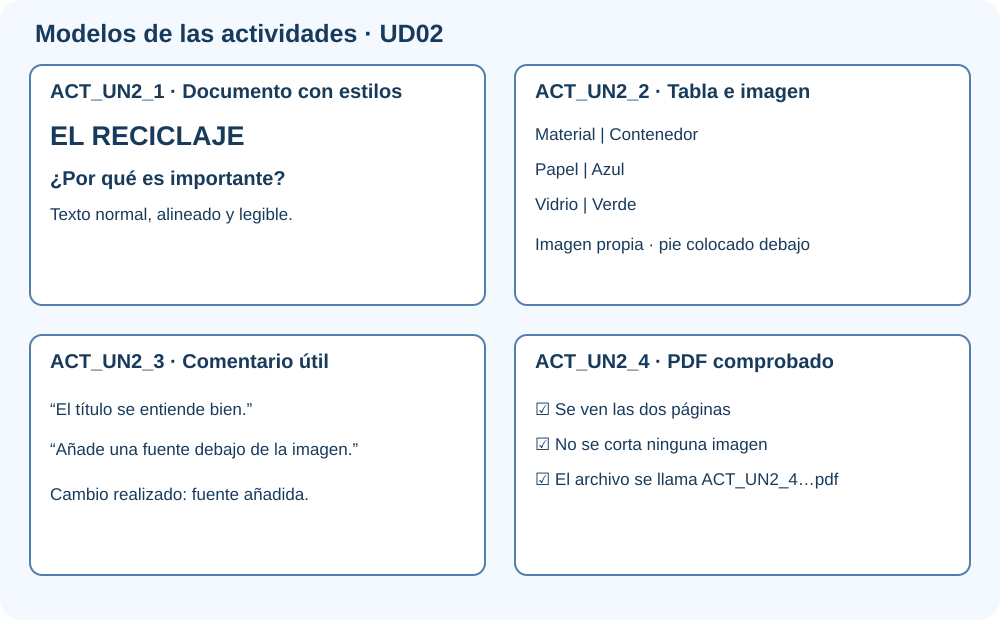

# Actividades · Procesador de textos en la nube

Estas actividades te enseñan, paso a paso, las herramientas que utilizarás para crear la guía de la **Feria Digital Responsable**.

Trabaja en **LliureX**, con los menús en español. Lee **un paso cada vez** y comprueba el resultado antes de seguir. Las actividades de texto usan **LibreOffice Writer**; las hojas de cálculo, **Calc**; las presentaciones, **Impress**. Cada actividad concreta su herramienta y sus archivos de entrega.

| Código en Aules | Actividad |
|---|---|
| ACT_UN2_1 | Aplicar estilos a un documento desordenado |
| ACT_UN2_2 | Crear una tabla y una imagen acreditada |
| ACT_UN2_3 | Revisión por parejas con comentarios |
| ACT_UN2_4 | Exportar, comprobar y entregar un PDF |

## ACT_UN2_1 · Aplicar estilos a un documento desordenado

### ¿Qué vas a hacer?

Aplicar estilos de Writer a un texto para distinguir título, apartados y lista.

**Herramienta:** LibreOffice Writer.

**Dónde guardar:** `Documentos/FERIA_DIGITAL_TUNOMBRE/UD02_GUIA/ACTIVIDADES`. Si falta alguna carpeta, abre el **Gestor de archivos → Documentos**, entra en la carpeta anterior y créala con **clic derecho → Crear carpeta**. Cambia `TUNOMBRE` por tu nombre de aula.

!!! example "Ejemplo de resultado"
    Un título con estilo **Título**, dos apartados con **Título 1** y el texto normal sin tamaños puestos manualmente.

### Pasos

1. Abre **Menú de aplicaciones → Oficina → LibreOffice Writer**. Pulsa **Archivo → Nuevo → Documento de texto**.
2. Escribe estos párrafos, cada uno separado por **Intro**: `Feria Digital Responsable`, `Qué veremos`, `Veremos presupuestos, ejemplos de IA y videojuegos.`, `Normas de visita`, `Respetar los turnos`, `Cuidar los equipos` y `Pedir permiso antes de hacer fotos`.
3. Haz clic dentro del primer párrafo. En el desplegable de estilos de la barra superior, donde suele aparecer **Estilo de párrafo predeterminado**, elige **Título**.
4. Haz clic en `Qué veremos` y elige el estilo **Título 1** (puede aparecer como **Encabezado 1** según la versión o el idioma). Repite con `Normas de visita`.
5. Selecciona las tres normas y pulsa **Mayús + F12** para activar las viñetas.
6. Haz clic en la frase que empieza por `Veremos` y aplica **Cuerpo de texto**. Comprueba que los dos apartados tienen el mismo estilo y que las normas aparecen con viñetas.
7. Pulsa **Archivo → Guardar como**. Abre tu carpeta de esta unidad, escribe `ACT_UN2_1_ApellidoNombre_v01.odt` y conserva el formato OpenDocument correspondiente. Sustituye `ApellidoNombre` por tu apellido y nombre. Pulsa **Guardar** y, si pregunta el formato, elige **Usar formato OpenDocument**.
8. Para crear el PDF, pulsa **Archivo → Exportar como → Exportar como PDF → Exportar**, escribe el mismo nombre del editable y pulsa **Guardar**. Abre el PDF desde el Gestor de archivos y comprueba que no hay texto cortado.
9. Abre **Firefox**, entra en Aules con tu cuenta del centro y abre **Informática → UD02 → ACT_UN2_1**. Pulsa **Agregar entrega** (o **Editar entrega** si ya existe), arrastra los archivos pedidos al recuadro y pulsa **Guardar cambios**. Si aparece **Enviar tarea**, púlsalo y confirma. Comprueba que se ven tus archivos y que la entrega figura enviada.

### ¿Qué debes entregar?

- `ACT_UN2_1_ApellidoNombre_v01.odt`
- `ACT_UN2_1_ApellidoNombre_v01.pdf`
- Si utilizaste IA, indica la herramienta, para qué la usaste y cómo revisaste el resultado. Si no la usaste, indícalo sin inventar consultas.

### Antes de enviar

- [ ] Los apartados usan el mismo estilo y las normas forman una lista.
- [ ] He abierto el archivo guardado y se ve completo.
- [ ] Los archivos tienen el nombre pedido y están adjuntos en Aules.
- [ ] No incluyo contraseñas, direcciones, teléfonos ni datos de otras personas.

## ACT_UN2_2 · Crear una tabla y una imagen acreditada

### ¿Qué vas a hacer?

Insertar una tabla y una imagen propia con un pie que indique su autoría.

**Herramienta:** LibreOffice Writer y LibreOffice Draw.

**Dónde guardar:** `Documentos/FERIA_DIGITAL_TUNOMBRE/UD02_GUIA/ACTIVIDADES`. Si falta alguna carpeta, abre el **Gestor de archivos → Documentos**, entra en la carpeta anterior y créala con **clic derecho → Crear carpeta**. Cambia `TUNOMBRE` por tu nombre de aula.

!!! example "Ejemplo de resultado"
    Tabla `Herramienta | Uso` con tres filas y una imagen con el pie `Fuente: autor - sitio web - enlace`.

### Pasos

1. Abre **Menú de aplicaciones → Oficina → LibreOffice Writer**. Pulsa **Archivo → Nuevo → Documento de texto**.
2. Escribe `Herramientas para la Feria Digital`. Pulsa **Intro** y después **Tabla → Insertar tabla**. Indica **2 columnas y 4 filas** y pulsa **Insertar**.
3. Escribe en la primera fila `Herramienta` y `Uso`. Completa las otras filas con `Writer | Crear la guía`, `Calc | Calcular el presupuesto` e `Impress | Presentar la feria`. Usa **Tab** para pasar a la siguiente celda.
4. Abre **Menú de aplicaciones → Oficina → LibreOffice Draw**. Pulsa **Insertar → Forma → Formas básicas → Rectángulo** y dibuja una pantalla. Añade un segundo rectángulo pequeño debajo como soporte. Es una ilustración propia de un monitor.
5. En Draw selecciona los dos rectángulos arrastrando un recuadro alrededor y pulsa **Ctrl + C**. Vuelve a Writer, haz clic debajo de la tabla y pulsa **Ctrl + V**.
6. Haz clic derecho sobre el dibujo y elige **Ancla → Como carácter** para colocarlo dentro del texto. Para cambiar su tamaño, arrastra un tirador de una esquina manteniendo las proporciones.
7. Debajo escribe `Ilustración de un monitor. Autoría: elaboración propia con LibreOffice Draw. Sin fuente externa.` Si sustituyes el dibujo por una imagen ajena, copia de su página el autor, la URL y la licencia concreta.
8. Comprueba que hay tres herramientas, que el monitor conserva sus proporciones y que su autoría aparece debajo.
9. Pulsa **Archivo → Guardar como**. Abre tu carpeta de esta unidad, escribe `ACT_UN2_2_ApellidoNombre_v01.odt` y conserva el formato OpenDocument correspondiente. Sustituye `ApellidoNombre` por tu apellido y nombre. Pulsa **Guardar** y, si pregunta el formato, elige **Usar formato OpenDocument**.
10. Para crear el PDF, pulsa **Archivo → Exportar como → Exportar como PDF → Exportar**, escribe el mismo nombre del editable y pulsa **Guardar**. Abre el PDF desde el Gestor de archivos y comprueba que no hay texto cortado.
11. Abre **Firefox**, entra en Aules con tu cuenta del centro y abre **Informática → UD02 → ACT_UN2_2**. Pulsa **Agregar entrega** (o **Editar entrega** si ya existe), arrastra los archivos pedidos al recuadro y pulsa **Guardar cambios**. Si aparece **Enviar tarea**, púlsalo y confirma. Comprueba que se ven tus archivos y que la entrega figura enviada.

### ¿Qué debes entregar?

- `ACT_UN2_2_ApellidoNombre_v01.odt`
- `ACT_UN2_2_ApellidoNombre_v01.pdf`
- Si utilizaste IA, indica la herramienta, para qué la usaste y cómo revisaste el resultado. Si no la usaste, indícalo sin inventar consultas.

### Antes de enviar

- [ ] La tabla tiene tres herramientas y la imagen tiene autoría.
- [ ] He abierto el archivo guardado y se ve completo.
- [ ] Los archivos tienen el nombre pedido y están adjuntos en Aules.
- [ ] No incluyo contraseñas, direcciones, teléfonos ni datos de otras personas.

## ACT_UN2_3 · Revisión por parejas con comentarios

### ¿Qué vas a hacer?

Intercambiar documentos, añadir dos comentarios útiles y mejorar tu propio trabajo.

**Herramienta:** LibreOffice Writer y la carpeta de intercambio del aula.

**Dónde guardar:** `Documentos/FERIA_DIGITAL_TUNOMBRE/UD02_GUIA/ACTIVIDADES`. Si falta alguna carpeta, abre el **Gestor de archivos → Documentos**, entra en la carpeta anterior y créala con **clic derecho → Crear carpeta**. Cambia `TUNOMBRE` por tu nombre de aula.

!!! example "Ejemplo de resultado"
    Comentario útil: «El título se entiende. La imagen es pequeña. Auméntala y añade su fuente».

### Pasos

1. Abre **LibreOffice Writer → Archivo → Abrir** y selecciona tu documento `.odt` de **ACT_UN2_2**. Usa **Archivo → Guardar como** para crear una copia con el nombre de esta actividad. Mantén el formato **ODF (.odt)**.
2. En el Gestor de archivos selecciona esa copia y pulsa **Ctrl + C**. Abre la carpeta de intercambio que el profesor muestre en el equipo del aula y pulsa **Ctrl + V**. Tu compañero copiará el archivo a su carpeta antes de abrirlo. Si no hay carpeta compartida, intercambiadlo mediante el procedimiento de aula que indique el profesor; no necesitáis crear cuentas.
3. Abre en Writer la copia de tu compañero y lee el documento completo. En un archivo local de Writer no se cambia a un permiso de «solo comentario»: el acuerdo es comentar sin modificar el texto.
4. Selecciona con el ratón el título o una frase bien conseguida. Pulsa **Insertar → Comentario**, escribe `El título explica el tema y se identifica fácilmente` u otra valoración concreta, y haz clic fuera del comentario.
5. Selecciona otra parte mejorable, vuelve a **Insertar → Comentario** y escribe una propuesta concreta. Ejemplo: `La imagen ocupa casi toda la página; redúcela desde una esquina para que la tabla se vea completa`.
6. Pulsa **Ctrl + S**, cierra el archivo y devuelve la copia comentada a su autor por la misma carpeta de intercambio. Conserva su nombre para que no se confunda con tu propio trabajo.
7. Recupera y abre tu documento comentado. Si no ves las notas del margen, activa **Ver → Comentarios**. Lee las dos notas y aplica una mejora.
8. En el menú del comentario atendido selecciona **Resolver comentario**, si tu versión lo permite. Si no aparece, responde dentro del comentario con `Aplicado: ...` y explica el cambio. Conserva los comentarios como evidencia.
9. Al final del documento escribe `He cambiado… porque…`. Guarda tu documento con los comentarios recibidos. Si has cambiado el nombre que aparece como autor, usa únicamente tu nombre de aula, sin otros datos personales.
10. Pulsa **Archivo → Guardar como**. Abre tu carpeta de esta unidad, escribe `ACT_UN2_3_ApellidoNombre_v01.odt` y conserva el formato OpenDocument correspondiente. Sustituye `ApellidoNombre` por tu apellido y nombre. Pulsa **Guardar** y, si pregunta el formato, elige **Usar formato OpenDocument**.
11. Abre **Firefox**, entra en Aules con tu cuenta del centro y abre **Informática → UD02 → ACT_UN2_3**. Pulsa **Agregar entrega** (o **Editar entrega** si ya existe), arrastra los archivos pedidos al recuadro y pulsa **Guardar cambios**. Si aparece **Enviar tarea**, púlsalo y confirma. Comprueba que se ven tus archivos y que la entrega figura enviada.

### ¿Qué debes entregar?

- `ACT_UN2_3_ApellidoNombre_v01.odt`
- Si utilizaste IA, indica la herramienta, para qué la usaste y cómo revisaste el resultado. Si no la usaste, indícalo sin inventar consultas.

### Antes de enviar

- [ ] Conservo dos comentarios recibidos y explico una mejora aplicada.
- [ ] He abierto el archivo guardado y se ve completo.
- [ ] Los archivos tienen el nombre pedido y están adjuntos en Aules.
- [ ] No incluyo contraseñas, direcciones, teléfonos ni datos de otras personas.

## ACT_UN2_4 · Exportar, comprobar y entregar un PDF

### ¿Qué vas a hacer?

Exportar un documento de Writer a PDF y comprobar que conserva todo el contenido.

**Herramienta:** LibreOffice Writer y Visor de documentos de LliureX.

**Dónde guardar:** `Documentos/FERIA_DIGITAL_TUNOMBRE/UD02_GUIA/ACTIVIDADES`. Si falta alguna carpeta, abre el **Gestor de archivos → Documentos**, entra en la carpeta anterior y créala con **clic derecho → Crear carpeta**. Cambia `TUNOMBRE` por tu nombre de aula.

!!! example "Ejemplo de resultado"
    Un PDF que abre correctamente, mantiene imágenes y tabla completas y muestra el nombre de la actividad en la primera página.

### Pasos

1. Abre **LibreOffice Writer → Archivo → Abrir** y selecciona el `.odt` corregido de **ACT_UN2_3**.
2. Pulsa **Archivo → Guardar como** y crea una copia con el nombre de esta actividad y extensión `.odt`.
3. Comprueba que se ven el título, la tabla, la imagen y el pie de autoría. Corrige palabras cortadas y elimina párrafos vacíos al final.
4. Para crear el PDF, pulsa **Archivo → Exportar como → Exportar como PDF → Exportar**, escribe el mismo nombre del editable y pulsa **Guardar**. Abre el PDF desde el Gestor de archivos y comprueba que no hay texto cortado.
5. En el PDF revisa la primera y la última página. Comprueba que no falta ninguna fila de la tabla y que la imagen y su pie están completos.
6. Si detectas un fallo, vuelve al `.odt`, corrígelo, pulsa **Ctrl + S** y exporta de nuevo sustituyendo el PDF anterior.
7. En Writer añade al final `Comprobación: título, tabla, imagen y última página revisados`. Guarda y exporta otra vez para que la comprobación figure también en el PDF.
8. Pulsa **Archivo → Guardar como**. Abre tu carpeta de esta unidad, escribe `ACT_UN2_4_ApellidoNombre_v01.odt` y conserva el formato OpenDocument correspondiente. Sustituye `ApellidoNombre` por tu apellido y nombre. Pulsa **Guardar** y, si pregunta el formato, elige **Usar formato OpenDocument**.
9. Para crear el PDF, pulsa **Archivo → Exportar como → Exportar como PDF → Exportar**, escribe el mismo nombre del editable y pulsa **Guardar**. Abre el PDF desde el Gestor de archivos y comprueba que no hay texto cortado.
10. Abre **Firefox**, entra en Aules con tu cuenta del centro y abre **Informática → UD02 → ACT_UN2_4**. Pulsa **Agregar entrega** (o **Editar entrega** si ya existe), arrastra los archivos pedidos al recuadro y pulsa **Guardar cambios**. Si aparece **Enviar tarea**, púlsalo y confirma. Comprueba que se ven tus archivos y que la entrega figura enviada.

### ¿Qué debes entregar?

- `ACT_UN2_4_ApellidoNombre_v01.odt`
- `ACT_UN2_4_ApellidoNombre_v01.pdf`
- Si utilizaste IA, indica la herramienta, para qué la usaste y cómo revisaste el resultado. Si no la usaste, indícalo sin inventar consultas.

### Antes de enviar

- [ ] El PDF contiene el título, la tabla y la imagen completos.
- [ ] He abierto el archivo guardado y se ve completo.
- [ ] Los archivos tienen el nombre pedido y están adjuntos en Aules.
- [ ] No incluyo contraseñas, direcciones, teléfonos ni datos de otras personas.

!!! info "Mecanografía"
    Una vez por semana se dedicarán entre cinco y diez minutos a mecanografía en forma de juego. Abre **Firefox** y el enlace de mecanografía que figura en la sección de tu curso en Aules. Solo se entrega si el profesor lo indica.
