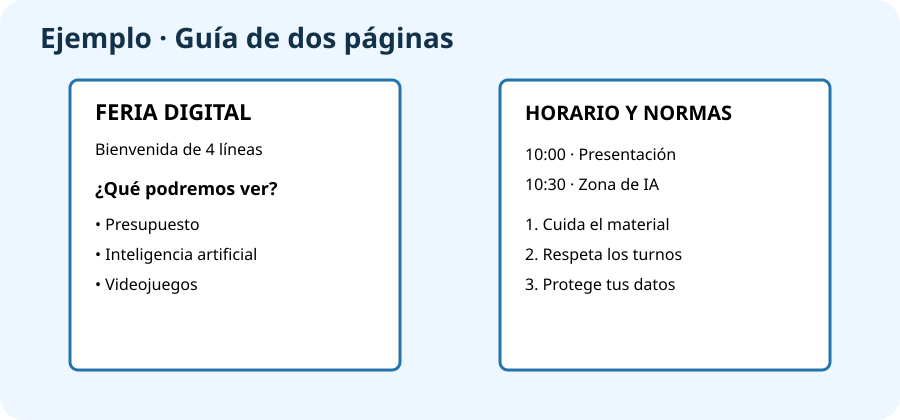

# PROY_UN2 · Guía de la Feria Digital

## Continuamos el proyecto

En la unidad anterior organizaste las carpetas. Ahora crearás el primer material de la **Feria Digital Responsable**: una guía de dos páginas para sus visitantes.

## ¿Qué tienes que hacer?

Con **LibreOffice Writer**, crea una guía que explique qué es la feria, qué encontrarán los visitantes y tres normas para participar correctamente.

!!! example "Ejemplo de contenido"
    **Página 1:** `Bienvenidos a la Feria Digital`, una explicación de cuatro líneas y tres espacios: presupuesto, inteligencia artificial y videojuegos. **Página 2:** horario inventado, tres normas y una imagen con su fuente.

## Pasos

1. Abre **Menú de aplicaciones → Oficina → LibreOffice Writer → Archivo → Nuevo → Documento de texto**. Guarda con **Archivo → Guardar como** el archivo `PROY_UN2_ApellidoNombre.odt` en `Documentos/FERIA_DIGITAL_TUNOMBRE/UD02_GUIA`.
2. Escribe `Guía de la Feria Digital Responsable`. Haz clic en ese párrafo y elige **Título** en el desplegable de estilos de la barra superior.
3. Pulsa Intro y redacta una bienvenida de cuatro o cinco líneas: qué es la feria, a quién va dirigida y qué podrán aprender los visitantes. Usa **Cuerpo de texto**.
4. Escribe `¿Qué podremos ver?` y aplica **Título 1** o **Encabezado 1**. Debajo describe tres espacios: presupuesto, inteligencia artificial y videojuegos.
5. Sitúa el cursor después del último párrafo y pulsa **Ctrl + Intro** para comenzar la segunda página. Escribe `Horario y normas` y aplica el mismo estilo de apartado.
6. Pulsa **Tabla → Insertar tabla** y elige **2 columnas y 4 filas**. Encabezados: `Hora` y `Actividad`. Añade tres horarios inventados, por ejemplo `10:00 | Apertura`, `10:30 | Visita a los espacios` y `11:00 | Prueba de videojuegos`.
7. Debajo escribe tres normas, una por línea. Selecciónalas y pulsa **Mayús + F12** para convertirlas en una lista con viñetas.
8. Inserta el dibujo propio del monitor de ACT_UN2_2: abre aquel ODT, copia el dibujo y pégalo debajo de las normas. Escribe `Ilustración: elaboración propia con LibreOffice Draw`. Si usas otra imagen, añade autor, URL y licencia.
9. Pulsa **Herramientas → Ortografía** y revisa las propuestas. Mira el contador de páginas de la barra inferior: deben ser dos. Si sobra contenido, acorta el texto y ajusta la imagen sin deformarla.
10. Pulsa **Ctrl + S**. Usa **Archivo → Exportar como → Exportar como PDF → Exportar** y guarda `PROY_UN2_ApellidoNombre.pdf` junto al ODT. Abre el PDF para comprobar que ambas páginas están completas.

## Entrega en Aules

Abre **Firefox → Aules → tu curso de Informática → UD02 → PROY_UN2**. Pulsa **Agregar entrega**, arrastra los archivos indicados abajo y pulsa **Guardar cambios**. Si aparece **Enviar tarea**, púlsalo y confirma. Comprueba que la entrega muestra tus archivos.

- `PROY_UN2_ApellidoNombre.odt`
- `PROY_UN2_ApellidoNombre.pdf`

Guarda también ambos archivos dentro de `UD02_GUIA`.

## Puntuación (10 puntos)

| Se comprobará | Puntos |
|---|---:|
| Explica la feria y sus tres espacios | 3 |
| Incluye horario, normas, imagen y fuente | 3 |
| Está bien organizado y se lee con facilidad | 2 |
| Entrega ODT y PDF de dos páginas | 2 |

!!! tip "Lo usarás después"
    Los espacios que presentes aquí aparecerán de nuevo en el presupuesto y en la presentación de las siguientes unidades.
