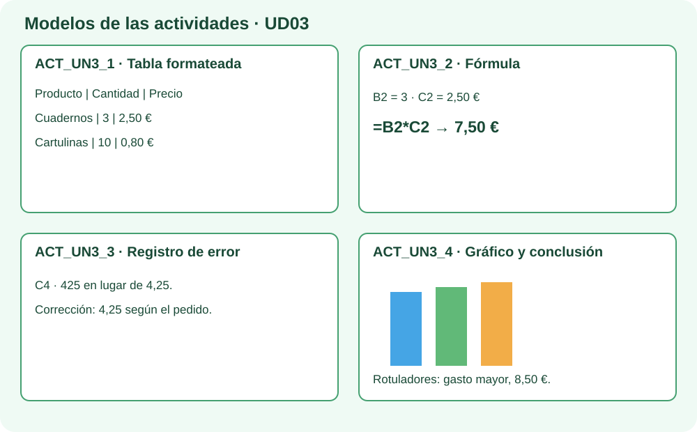

# Actividades · Hojas de cálculo

Estas actividades preparan el presupuesto de la **Feria Digital Responsable**. Compara tus tablas, fórmulas y gráficos con este modelo.

Trabaja en **LliureX**, con los menús en español. Lee **un paso cada vez** y comprueba el resultado antes de seguir. Las actividades de texto usan **LibreOffice Writer**; las hojas de cálculo, **Calc**; las presentaciones, **Impress**. Cada actividad concreta su herramienta y sus archivos de entrega.

| Código en Aules | Actividad |
|---|---|
| ACT_UN3_1 | Completar una tabla con formatos adecuados |
| ACT_UN3_2 | Construir fórmulas básicas y comprobarlas |
| ACT_UN3_3 | Detectar cinco errores en datos ficticios |
| ACT_UN3_4 | Crear un gráfico y escribir dos conclusiones |

## ACT_UN3_1 · Completar una tabla con formatos adecuados

### ¿Qué vas a hacer?

Crear una tabla de materiales y distinguir texto, cantidades enteras y precios.

**Herramienta:** LibreOffice Calc.

**Dónde guardar:** `Documentos/FERIA_DIGITAL_TUNOMBRE/UD03_PRESUPUESTO/ACTIVIDADES`. Si falta alguna carpeta, abre el **Gestor de archivos → Documentos**, entra en la carpeta anterior y créala con **clic derecho → Crear carpeta**. Cambia `TUNOMBRE` por tu nombre de aula.

!!! example "Ejemplo de resultado"
    Tabla `Producto | Cantidad | Precio` con encabezados destacados, cantidades enteras y precios en formato moneda.

### Pasos

1. Abre **Menú de aplicaciones → Oficina → LibreOffice Calc**. Pulsa **Archivo → Nuevo → Hoja de cálculo**.
2. Localiza las letras de las columnas arriba y los números de las filas a la izquierda. La celda **A1** está en la intersección de la columna A y la fila 1.
3. Introduce estos datos: A1 `Producto`, B1 `Cantidad`, C1 `Precio unidad`; A2 `Cuadernos`, B2 `3`, C2 `2,50`; A3 `Cartulinas`, B3 `10`, C3 `0,80`; A4 `Rotuladores`, B4 `2`, C4 `4,25`. Haz clic en cada celda, escribe el contenido y pulsa **Intro**. No escribas el símbolo € dentro del número.
4. Selecciona **A1:C1**: pulsa A1 y arrastra hasta C1. Pulsa **Negrita** y aplica un color de fondo claro desde la barra de herramientas.
5. Selecciona **B2:B4**. Pulsa **Formato → Celdas → Números**, elige **Número**, fija **0 decimales** y pulsa **Aceptar**.
6. Selecciona **C2:C4**. Pulsa **Formato → Celdas → Números**, elige **Moneda**, símbolo **€**, **2 decimales** y pulsa **Aceptar**.
7. Para que los encabezados se lean, haz doble clic en la separación entre las letras A y B; repite entre B y C y entre C y D. Así se ajusta el ancho de cada columna.
8. Comprueba B2: debe mostrar `3`, sin decimales. Comprueba C2: debe mostrar `2,50 €`. Haz clic en C2 y comprueba que la barra de entrada conserva un valor numérico.
9. Pulsa **Archivo → Guardar como**. Abre tu carpeta de esta unidad, escribe `ACT_UN3_1_ApellidoNombre_v01.ods` y conserva el formato OpenDocument correspondiente. Sustituye `ApellidoNombre` por tu apellido y nombre. Pulsa **Guardar** y, si pregunta el formato, elige **Usar formato OpenDocument**.
10. Abre **Firefox**, entra en Aules con tu cuenta del centro y abre **Informática → UD03 → ACT_UN3_1**. Pulsa **Agregar entrega** (o **Editar entrega** si ya existe), arrastra los archivos pedidos al recuadro y pulsa **Guardar cambios**. Si aparece **Enviar tarea**, púlsalo y confirma. Comprueba que se ven tus archivos y que la entrega figura enviada.

### ¿Qué debes entregar?

- `ACT_UN3_1_ApellidoNombre_v01.ods`
- Si utilizaste IA, indica la herramienta, para qué la usaste y cómo revisaste el resultado. Si no la usaste, indícalo sin inventar consultas.

### Antes de enviar

- [ ] Las cantidades son enteras y los precios se muestran en euros.
- [ ] He abierto el archivo guardado y se ve completo.
- [ ] Los archivos tienen el nombre pedido y están adjuntos en Aules.
- [ ] No incluyo contraseñas, direcciones, teléfonos ni datos de otras personas.

## ACT_UN3_2 · Construir fórmulas básicas y comprobarlas

### ¿Qué vas a hacer?

Calcular subtotales y total con fórmulas que cambian al modificar un dato.

**Herramienta:** LibreOffice Calc.

**Dónde guardar:** `Documentos/FERIA_DIGITAL_TUNOMBRE/UD03_PRESUPUESTO/ACTIVIDADES`. Si falta alguna carpeta, abre el **Gestor de archivos → Documentos**, entra en la carpeta anterior y créala con **clic derecho → Crear carpeta**. Cambia `TUNOMBRE` por tu nombre de aula.

!!! example "Ejemplo de resultado"
    Si B2 contiene 3 y C2 contiene 2,50 €, `=B2*C2` debe mostrar **7,50 €**.

### Pasos

1. Abre **LibreOffice Calc → Archivo → Abrir** y selecciona el archivo `.ods` de **ACT_UN3_1**. Pulsa **Archivo → Guardar como** y crea la copia de esta actividad.
2. Si no tienes el archivo anterior, abre **Archivo → Nuevo → Hoja de cálculo**. Introduce estos datos: A1 `Producto`, B1 `Cantidad`, C1 `Precio unidad`; A2 `Cuadernos`, B2 `3`, C2 `2,50`; A3 `Cartulinas`, B3 `10`, C3 `0,80`; A4 `Rotuladores`, B4 `2`, C4 `4,25`. Haz clic en cada celda, escribe el contenido y pulsa **Intro**. No escribas el símbolo € dentro del número.
3. En **D1** escribe `Subtotal`. En **D2** escribe exactamente `=B2*C2` y pulsa **Intro**. Debe aparecer `7,5` o `7,50 €`.
4. Haz clic en D2. Arrastra el pequeño cuadrado de su esquina inferior derecha hasta D4. Al hacer clic en D3, la barra de fórmulas debe mostrar `=B3*C3`.
5. En **C5** escribe `TOTAL`. En **D5** escribe `=SUMA(D2:D4)` y pulsa **Intro**.
6. Selecciona **D2:D5 → Formato → Celdas → Números → Moneda**, elige euros y dos decimales. Los subtotales deben ser **7,50 €**, **8,00 €** y **8,50 €**; el total, **24,00 €**.
7. Abre **Menú de aplicaciones → Calculadora**. Calcula `3 × 2,50` y después `7,50 + 8 + 8,50`. Compara ambos resultados con Calc.
8. En B2 cambia `3` por `4`. D2 debe pasar a **10,00 €** y D5 a **26,50 €**. Después devuelve B2 a `3`. En A7 escribe `Comprobado con calculadora y cambio de cantidad`.
9. Pulsa **Archivo → Guardar como**. Abre tu carpeta de esta unidad, escribe `ACT_UN3_2_ApellidoNombre_v01.ods` y conserva el formato OpenDocument correspondiente. Sustituye `ApellidoNombre` por tu apellido y nombre. Pulsa **Guardar** y, si pregunta el formato, elige **Usar formato OpenDocument**.
10. Abre **Firefox**, entra en Aules con tu cuenta del centro y abre **Informática → UD03 → ACT_UN3_2**. Pulsa **Agregar entrega** (o **Editar entrega** si ya existe), arrastra los archivos pedidos al recuadro y pulsa **Guardar cambios**. Si aparece **Enviar tarea**, púlsalo y confirma. Comprueba que se ven tus archivos y que la entrega figura enviada.

### ¿Qué debes entregar?

- `ACT_UN3_2_ApellidoNombre_v01.ods`
- Si utilizaste IA, indica la herramienta, para qué la usaste y cómo revisaste el resultado. Si no la usaste, indícalo sin inventar consultas.

### Antes de enviar

- [ ] Hay fórmulas en D2:D5 y el total original es 24,00 €.
- [ ] He abierto el archivo guardado y se ve completo.
- [ ] Los archivos tienen el nombre pedido y están adjuntos en Aules.
- [ ] No incluyo contraseñas, direcciones, teléfonos ni datos de otras personas.

## ACT_UN3_3 · Detectar cinco errores en datos ficticios

### ¿Qué vas a hacer?

Encontrar cinco errores concretos, corregir una copia y explicar cada corrección.

**Herramienta:** LibreOffice Calc.

**Dónde guardar:** `Documentos/FERIA_DIGITAL_TUNOMBRE/UD03_PRESUPUESTO/ACTIVIDADES`. Si falta alguna carpeta, abre el **Gestor de archivos → Documentos**, entra en la carpeta anterior y créala con **clic derecho → Crear carpeta**. Cambia `TUNOMBRE` por tu nombre de aula.

!!! example "Ejemplo de resultado"
    Registro: `C4 | precio escrito como 425 | corrijo a 4,25 según el pedido fiable`.

### Pasos

1. Abre **Menú de aplicaciones → Oficina → LibreOffice Calc**. Pulsa **Archivo → Nuevo → Hoja de cálculo**.
2. Haz doble clic en la pestaña inferior **Hoja1** y cambia su nombre a `ORIGINAL`. En A1:D1 escribe `Producto`, `Cantidad`, `Precio unidad`, `Subtotal`.
3. Introduce este conjunto con errores preparados: A2 `Cuadernos`, B2 `3`, C2 `2,50`, D2 `=B2+C2`; A3 `Cartulinas`, B3 `-10`, C3 `0,80`, D3 `=B3*C3`; A4 `Rotuladores`, B4 `2`, C4 `425`, D4 `=B4*C4`; A5 `Cartulinas`, B5 `1`, C5 `3`, D5 `=B5*C5`. En C6 escribe `TOTAL` y en D6 `=SUMA(D2:D4)`.
4. Estos son los datos fiables del pedido: `Cuadernos: 3 a 2,50 €`; `Cartulinas: 10 a 0,80 €`; `Rotuladores: 2 a 4,25 €`; `Cinta: 1 a 3,00 €`. No modifiques la hoja ORIGINAL.
5. Haz clic derecho en la pestaña **ORIGINAL → Mover o copiar hoja**. Marca **Copiar**, confirma y llama `CORREGIDA` a la nueva hoja.
6. En CORREGIDA compara cada fila con el pedido fiable. Revisa también si los subtotales multiplican y si el total incluye las cuatro filas.
7. Corrige los cinco fallos: D2 debe ser `=B2*C2`; B3 debe ser `10`; C4 debe ser `4,25`; A5 debe ser `Cinta`; D6 debe ser `=SUMA(D2:D5)`.
8. Comprueba los subtotales **7,50**, **8,00**, **8,50** y **3,00**, y el total **27,00**. Aplica formato moneda a C2:D6, excepto la celda C6 que contiene el rótulo.
9. En F1:H1 escribe `Celda`, `Error` y `Corrección`. Completa las filas 2 a 6 con los cinco fallos y una explicación propia. Ensancha las columnas para leerlas.
10. Pulsa **Archivo → Guardar como**. Abre tu carpeta de esta unidad, escribe `ACT_UN3_3_ApellidoNombre_v01.ods` y conserva el formato OpenDocument correspondiente. Sustituye `ApellidoNombre` por tu apellido y nombre. Pulsa **Guardar** y, si pregunta el formato, elige **Usar formato OpenDocument**.
11. Abre **Firefox**, entra en Aules con tu cuenta del centro y abre **Informática → UD03 → ACT_UN3_3**. Pulsa **Agregar entrega** (o **Editar entrega** si ya existe), arrastra los archivos pedidos al recuadro y pulsa **Guardar cambios**. Si aparece **Enviar tarea**, púlsalo y confirma. Comprueba que se ven tus archivos y que la entrega figura enviada.

### ¿Qué debes entregar?

- `ACT_UN3_3_ApellidoNombre_v01.ods`
- Si utilizaste IA, indica la herramienta, para qué la usaste y cómo revisaste el resultado. Si no la usaste, indícalo sin inventar consultas.

### Antes de enviar

- [ ] Conservo ORIGINAL, CORREGIDA y el registro de cinco errores.
- [ ] He abierto el archivo guardado y se ve completo.
- [ ] Los archivos tienen el nombre pedido y están adjuntos en Aules.
- [ ] No incluyo contraseñas, direcciones, teléfonos ni datos de otras personas.

## ACT_UN3_4 · Crear un gráfico y escribir dos conclusiones

### ¿Qué vas a hacer?

Crear un gráfico de columnas con los gastos y escribir dos conclusiones con cifras.

**Herramienta:** LibreOffice Calc.

**Dónde guardar:** `Documentos/FERIA_DIGITAL_TUNOMBRE/UD03_PRESUPUESTO/ACTIVIDADES`. Si falta alguna carpeta, abre el **Gestor de archivos → Documentos**, entra en la carpeta anterior y créala con **clic derecho → Crear carpeta**. Cambia `TUNOMBRE` por tu nombre de aula.

!!! example "Ejemplo de resultado"
    Gráfico de columnas con título y ejes. Conclusión: «Rotuladores es el gasto mayor: 8,50 €».

### Pasos

1. Abre **LibreOffice Calc → Archivo → Abrir** y selecciona el `.ods` de **ACT_UN3_2**. Pulsa **Archivo → Guardar como** para crear la copia de esta actividad.
2. En **F1:G4** crea una tabla auxiliar: F1 `Producto`, G1 `Gasto (€)`; F2 `=A2`, G2 `=D2`; F3 `=A3`, G3 `=D3`; F4 `=A4`, G4 `=D4`.
3. Selecciona **F1:G4** arrastrando desde F1 hasta G4. Pulsa **Insertar → Gráfico** y elige **Columnas**.
4. En el asistente comprueba que la primera fila y la primera columna se usan como etiquetas. En el apartado de títulos escribe `Gastos de materiales`, eje X `Producto`, eje Y `Euros`. Pulsa **Finalizar**.
5. Haz clic fuera del gráfico para terminar su edición. Arrástralo a una zona vacía; amplíalo desde una esquina si los nombres se superponen.
6. En A8 escribe `El gasto mayor es Rotuladores: 8,50 €`. En A9 escribe `Cartulinas cuesta 0,50 € más que Cuadernos`. Comprueba cada cifra en la tabla.
7. Verifica que hay tres columnas y que ninguna representa el TOTAL. Si aparece una cuarta columna, edita el intervalo para que incluya solo F1:G4.
8. Pulsa **Archivo → Guardar como**. Abre tu carpeta de esta unidad, escribe `ACT_UN3_4_ApellidoNombre_v01.ods` y conserva el formato OpenDocument correspondiente. Sustituye `ApellidoNombre` por tu apellido y nombre. Pulsa **Guardar** y, si pregunta el formato, elige **Usar formato OpenDocument**.
9. Abre **Firefox**, entra en Aules con tu cuenta del centro y abre **Informática → UD03 → ACT_UN3_4**. Pulsa **Agregar entrega** (o **Editar entrega** si ya existe), arrastra los archivos pedidos al recuadro y pulsa **Guardar cambios**. Si aparece **Enviar tarea**, púlsalo y confirma. Comprueba que se ven tus archivos y que la entrega figura enviada.

### ¿Qué debes entregar?

- `ACT_UN3_4_ApellidoNombre_v01.ods`
- Si utilizaste IA, indica la herramienta, para qué la usaste y cómo revisaste el resultado. Si no la usaste, indícalo sin inventar consultas.

### Antes de enviar

- [ ] El gráfico representa tres productos y las dos conclusiones incluyen cifras.
- [ ] He abierto el archivo guardado y se ve completo.
- [ ] Los archivos tienen el nombre pedido y están adjuntos en Aules.
- [ ] No incluyo contraseñas, direcciones, teléfonos ni datos de otras personas.

!!! info "Mecanografía"
    Una vez por semana se dedicarán entre cinco y diez minutos a mecanografía en forma de juego. Abre **Firefox** y el enlace de mecanografía que figura en la sección de tu curso en Aules. Solo se entrega si el profesor lo indica.
