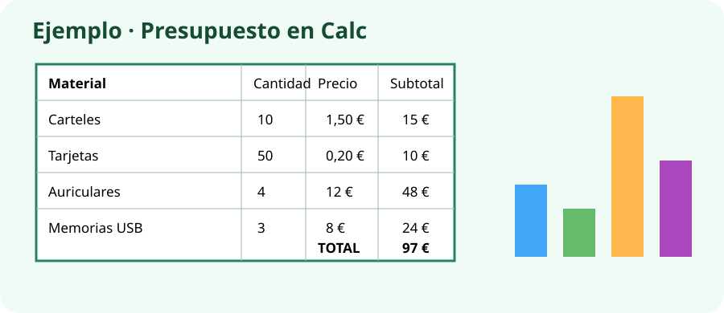

# PROY_UN3 · Presupuesto de la Feria Digital

## Continuamos el proyecto

Ya tienes una guía que explica la feria. Ahora calcularás con **LibreOffice Calc** cuánto costaría preparar sus materiales.

## ¿Qué tienes que hacer?

Crea una hoja con estos datos y utiliza fórmulas para obtener los subtotales y el total.

| Material | Cantidad | Precio por unidad |
|---|---:|---:|
| Carteles | 10 | 1,50 € |
| Tarjetas para visitantes | 50 | 0,20 € |
| Auriculares | 4 | 12 € |
| Memorias USB | 3 | 8 € |

!!! example "Resultados para comprobar"
    Los subtotales deben ser **15 €**, **10 €**, **48 €** y **24 €**. El total debe ser **97 €**.

## Pasos

1. Abre **Menú de aplicaciones → Oficina → LibreOffice Calc → Archivo → Nuevo → Hoja de cálculo**. Usa **Archivo → Guardar como** y guarda `PROY_UN3_ApellidoNombre.ods` en `Documentos/FERIA_DIGITAL_TUNOMBRE/UD03_PRESUPUESTO`.
2. Escribe en A1:D1 `Material`, `Cantidad`, `Precio unidad` y `Subtotal`. Copia los cuatro materiales de la tabla del enunciado en A2:C5. Introduce los precios como números, sin escribir €: `1,50`, `0,20`, `12` y `8`.
3. En D2 escribe `=B2*C2` y pulsa Intro. Selecciona D2 y arrastra el cuadradito de su esquina inferior derecha hasta D5. Comprueba los subtotales 15, 10, 48 y 24.
4. En C6 escribe `TOTAL`; en D6 escribe `=SUMA(D2:D5)`. Debe dar **97**. Selecciona C2:D5 y después D6 para aplicar **Formato → Celdas → Números → Moneda**, euros y dos decimales.
5. Selecciona A1:D1 y pulsa **Negrita**. Ajusta el ancho de las columnas haciendo doble clic en la separación entre sus letras para leer los encabezados completos.
6. Crea la tabla auxiliar F1:G5: F1 `Material`, G1 `Gasto (€)`; F2 `=A2`, G2 `=D2`. Repite las referencias para las filas 3, 4 y 5.
7. Selecciona F1:G5 → **Insertar → Gráfico → Columnas**. Activa etiquetas en primera fila y primera columna. Título `Gastos de la Feria Digital`, eje X `Material`, eje Y `Euros`. Pulsa **Finalizar** y mueve el gráfico debajo de A1:D6.
8. Cambia C2 a `2`: el subtotal de carteles debe ser 20 y el total 102. Vuelve a escribir `1,50`: el total debe recuperar 97. Guarda con **Ctrl + S**.
9. Selecciona A1:D25, incluyendo el gráfico; si este no cabe, redúcelo o amplía el rango. Pulsa **Formato → Intervalos de impresión → Definir**. En **Formato → Estilo de página → Hoja**, ajusta la escala para caber en una página de ancho y una de alto.
10. Pulsa **Archivo → Exportar como → Exportar como PDF → Exportar** y guarda `PROY_UN3_ApellidoNombre.pdf`. Abre el PDF: tabla y gráfico deben aparecer en una sola página y ser legibles.

## Entrega en Aules

Abre **Firefox → Aules → tu curso de Informática → UD03 → PROY_UN3**. Pulsa **Agregar entrega**, arrastra los archivos indicados abajo y pulsa **Guardar cambios**. Si aparece **Enviar tarea**, púlsalo y confirma. Comprueba que la entrega muestra tus archivos.

- `PROY_UN3_ApellidoNombre.ods`
- `PROY_UN3_ApellidoNombre.pdf`

Guárdalos también en `UD03_PRESUPUESTO`.

## Puntuación (10 puntos)

| Se comprobará | Puntos |
|---|---:|
| Datos y subtotales correctos | 3 |
| Total calculado mediante fórmula | 3 |
| Gráfico correcto y con título | 2 |
| Presentación clara y entrega ODS + PDF | 2 |

!!! tip "Lo usarás después"
    En la próxima unidad incluirás el total de 97 € y el gráfico en la presentación de la feria.
