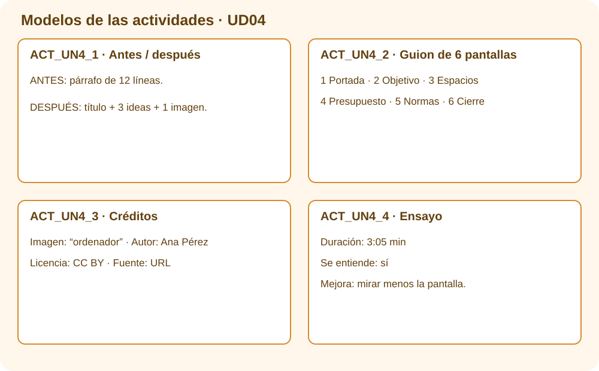

# Actividades · Presentaciones digitales

Estas actividades te preparan para presentar la **Feria Digital Responsable** reutilizando la guía y el presupuesto anteriores.

Trabaja en **LliureX**, con los menús en español. Lee **un paso cada vez** y comprueba el resultado antes de seguir. Las actividades de texto usan **LibreOffice Writer**; las hojas de cálculo, **Calc**; las presentaciones, **Impress**. Cada actividad concreta su herramienta y sus archivos de entrega.

| Código en Aules | Actividad |
|---|---|
| ACT_UN4_1 | Reducir una diapositiva saturada |
| ACT_UN4_2 | Crear una secuencia de seis diapositivas |
| ACT_UN4_3 | Acreditar tres imágenes reutilizables |
| ACT_UN4_4 | Ensayar con cronómetro y coevaluación |

## ACT_UN4_1 · Reducir una diapositiva saturada

### ¿Qué vas a hacer?

Transformar una diapositiva con demasiado texto en otra que puedas explicar con tres ideas.

**Herramienta:** LibreOffice Impress.

**Dónde guardar:** `Documentos/FERIA_DIGITAL_TUNOMBRE/UD04_PRESENTACION/ACTIVIDADES`. Si falta alguna carpeta, abre el **Gestor de archivos → Documentos**, entra en la carpeta anterior y créala con **clic derecho → Crear carpeta**. Cambia `TUNOMBRE` por tu nombre de aula.

!!! example "Ejemplo de resultado"
    Antes: párrafo de ocho líneas. Después: título, tres palabras clave y una imagen que apoye la explicación.

### Pasos

1. Abre **Menú de aplicaciones → Oficina → LibreOffice Impress**. Cierra el selector de plantillas para trabajar en una presentación vacía.
2. En la primera diapositiva usa el diseño **Título y contenido** del panel lateral. Haz clic en el cuadro del título y escribe `ANTES: una diapositiva saturada`.
3. En el cuadro de contenido copia este párrafo: `La Feria Digital Responsable tendrá una zona para explicar el presupuesto de materiales, otra para conocer usos de la inteligencia artificial y otra para probar videojuegos creados por el alumnado. Los visitantes respetarán los turnos, cuidarán los equipos y pedirán permiso antes de hacer fotografías. El objetivo es aprender a utilizar la tecnología con responsabilidad y compartir lo aprendido con otras personas.`
4. En la columna de miniaturas de la izquierda haz clic derecho en la primera diapositiva y elige **Duplicar diapositiva**.
5. En la segunda cambia el título a `DESPUÉS: tres espacios para aprender`. Sustituye el párrafo por tres líneas: `Presupuesto`, `Inteligencia artificial` y `Videojuegos`.
6. Selecciona las tres líneas y aplica un tamaño de **28 puntos** desde la barra superior. Usa **Insertar → Forma → Formas básicas** para dibujar un rectángulo que represente una pantalla, sin tapar el texto.
7. Pulsa **F5** para ver la presentación. Explica la segunda diapositiva en 30 segundos sin leer el párrafo original. Pulsa **Esc** para salir.
8. Comprueba que conservas dos diapositivas: la primera con el párrafo y la segunda con tres ideas breves y un dibujo.
9. Pulsa **Archivo → Guardar como**. Abre tu carpeta de esta unidad, escribe `ACT_UN4_1_ApellidoNombre_v01.odp` y conserva el formato OpenDocument correspondiente. Sustituye `ApellidoNombre` por tu apellido y nombre. Pulsa **Guardar** y, si pregunta el formato, elige **Usar formato OpenDocument**.
10. Para crear el PDF, pulsa **Archivo → Exportar como → Exportar como PDF → Exportar**, escribe el mismo nombre del editable y pulsa **Guardar**. Abre el PDF desde el Gestor de archivos y comprueba que no hay texto cortado.
11. Abre **Firefox**, entra en Aules con tu cuenta del centro y abre **Informática → UD04 → ACT_UN4_1**. Pulsa **Agregar entrega** (o **Editar entrega** si ya existe), arrastra los archivos pedidos al recuadro y pulsa **Guardar cambios**. Si aparece **Enviar tarea**, púlsalo y confirma. Comprueba que se ven tus archivos y que la entrega figura enviada.

### ¿Qué debes entregar?

- `ACT_UN4_1_ApellidoNombre_v01.odp`
- `ACT_UN4_1_ApellidoNombre_v01.pdf`
- Si utilizaste IA, indica la herramienta, para qué la usaste y cómo revisaste el resultado. Si no la usaste, indícalo sin inventar consultas.

### Antes de enviar

- [ ] Se ven el antes y el después de la misma diapositiva.
- [ ] He abierto el archivo guardado y se ve completo.
- [ ] Los archivos tienen el nombre pedido y están adjuntos en Aules.
- [ ] No incluyo contraseñas, direcciones, teléfonos ni datos de otras personas.

## ACT_UN4_2 · Crear una secuencia de seis diapositivas

### ¿Qué vas a hacer?

Preparar una secuencia de seis diapositivas con una idea principal en cada una.

**Herramienta:** LibreOffice Impress.

**Dónde guardar:** `Documentos/FERIA_DIGITAL_TUNOMBRE/UD04_PRESENTACION/ACTIVIDADES`. Si falta alguna carpeta, abre el **Gestor de archivos → Documentos**, entra en la carpeta anterior y créala con **clic derecho → Crear carpeta**. Cambia `TUNOMBRE` por tu nombre de aula.

!!! example "Ejemplo de resultado"
    1 Portada; 2 problema; 3 dato; 4 explicación; 5 propuesta; 6 conclusión y fuentes.

### Pasos

1. Abre **Menú de aplicaciones → Oficina → LibreOffice Impress**. Cierra el selector de plantillas para trabajar en una presentación vacía.
2. En la primera diapositiva escribe el título `Feria Digital Responsable` y el subtítulo `Aprendemos y compartimos tecnología`.
3. Pulsa **Diapositiva → Nueva diapositiva** cinco veces. Comprueba en la columna izquierda que hay seis miniaturas.
4. Selecciona la diapositiva 2. Escribe el título `El problema` y una frase sobre un uso poco responsable de la tecnología, por ejemplo compartir información sin comprobarla.
5. En la 3 escribe `Un dato del presupuesto` y `Los materiales de la feria cuestan 97 €`. Es el presupuesto del proyecto de la UD03; si aún no lo has realizado, señala `Dato del modelo de clase`.
6. En la 4 escribe `Qué aprenderemos` y tres líneas: `Comparar información`, `Calcular gastos` y `Crear videojuegos`.
7. En la 5 escribe `Nuestra propuesta` y tres acciones: `Verificar las fuentes`, `Cuidar los equipos` y `Respetar los turnos`.
8. En la 6 escribe `Ven a la Feria Digital` y, debajo, `Fuentes: guía UD02 y presupuesto modelo UD03`. Si usas otra información, añade su título y URL.
9. Selecciona el texto de contenido de cada diapositiva y utiliza al menos **24 puntos**. Pulsa **F5**, avanza con la flecha derecha y comprueba el orden de las seis. Sal con **Esc**.
10. Pulsa **Archivo → Guardar como**. Abre tu carpeta de esta unidad, escribe `ACT_UN4_2_ApellidoNombre_v01.odp` y conserva el formato OpenDocument correspondiente. Sustituye `ApellidoNombre` por tu apellido y nombre. Pulsa **Guardar** y, si pregunta el formato, elige **Usar formato OpenDocument**.
11. Para crear el PDF, pulsa **Archivo → Exportar como → Exportar como PDF → Exportar**, escribe el mismo nombre del editable y pulsa **Guardar**. Abre el PDF desde el Gestor de archivos y comprueba que no hay texto cortado.
12. Abre **Firefox**, entra en Aules con tu cuenta del centro y abre **Informática → UD04 → ACT_UN4_2**. Pulsa **Agregar entrega** (o **Editar entrega** si ya existe), arrastra los archivos pedidos al recuadro y pulsa **Guardar cambios**. Si aparece **Enviar tarea**, púlsalo y confirma. Comprueba que se ven tus archivos y que la entrega figura enviada.

### ¿Qué debes entregar?

- `ACT_UN4_2_ApellidoNombre_v01.odp`
- `ACT_UN4_2_ApellidoNombre_v01.pdf`
- Si utilizaste IA, indica la herramienta, para qué la usaste y cómo revisaste el resultado. Si no la usaste, indícalo sin inventar consultas.

### Antes de enviar

- [ ] Hay seis diapositivas y cada una desarrolla una idea.
- [ ] He abierto el archivo guardado y se ve completo.
- [ ] Los archivos tienen el nombre pedido y están adjuntos en Aules.
- [ ] No incluyo contraseñas, direcciones, teléfonos ni datos de otras personas.

## ACT_UN4_3 · Acreditar tres imágenes reutilizables

### ¿Qué vas a hacer?

Insertar tres imágenes reutilizables e indicar autor, origen y licencia de cada una.

**Herramienta:** Firefox y LibreOffice Impress.

**Dónde guardar:** `Documentos/FERIA_DIGITAL_TUNOMBRE/UD04_PRESENTACION/ACTIVIDADES`. Si falta alguna carpeta, abre el **Gestor de archivos → Documentos**, entra en la carpeta anterior y créala con **clic derecho → Crear carpeta**. Cambia `TUNOMBRE` por tu nombre de aula.

!!! example "Ejemplo de resultado"
    Pie visible: `Foto: María López - Wikimedia Commons - CC BY-SA - enlace`.

### Pasos

1. Abre **Menú de aplicaciones → Oficina → LibreOffice Impress**. Cierra el selector de plantillas para trabajar en una presentación vacía.
2. Crea tres diapositivas con **Diapositiva → Nueva diapositiva**. Titúlalas `Ordenador`, `Teclado` y `Ratón`.
3. Abre **Firefox** y entra en [Wikimedia Commons](https://commons.wikimedia.org/). Busca `computer`, abre la página de un archivo y localiza el autor y la licencia. Elige una imagen con licencia **CC BY**, **CC BY-SA** o **CC0** indicada en su ficha.
4. Guarda la imagen desde su página: abre la imagen original, haz clic derecho y elige **Guardar imagen como**. Anota en un documento temporal el autor, la licencia y la dirección de la ficha, no solo la dirección de la imagen.
5. Vuelve a Impress, selecciona la primera diapositiva y pulsa **Insertar → Imagen**. Elige el archivo descargado. Cambia el tamaño desde una esquina sin deformarlo.
6. Pulsa **Insertar → Cuadro de texto**, dibuja una caja debajo y escribe `Autor: ... | Fuente: Wikimedia Commons | Licencia: ... | URL de la ficha: ...`. Sustituye los puntos por la información real.
7. Repite la búsqueda y la inserción con `keyboard` y `computer mouse` para las otras dos diapositivas. Si una ficha no indica autoría o permiso de reutilización, escoge otra.
8. Pulsa **F5** y comprueba que cada imagen se distingue y que los tres pies pueden leerse. No escribas simplemente `Fuente: Google`: el buscador no es el autor.
9. Pulsa **Archivo → Guardar como**. Abre tu carpeta de esta unidad, escribe `ACT_UN4_3_ApellidoNombre_v01.odp` y conserva el formato OpenDocument correspondiente. Sustituye `ApellidoNombre` por tu apellido y nombre. Pulsa **Guardar** y, si pregunta el formato, elige **Usar formato OpenDocument**.
10. Para crear el PDF, pulsa **Archivo → Exportar como → Exportar como PDF → Exportar**, escribe el mismo nombre del editable y pulsa **Guardar**. Abre el PDF desde el Gestor de archivos y comprueba que no hay texto cortado.
11. Abre **Firefox**, entra en Aules con tu cuenta del centro y abre **Informática → UD04 → ACT_UN4_3**. Pulsa **Agregar entrega** (o **Editar entrega** si ya existe), arrastra los archivos pedidos al recuadro y pulsa **Guardar cambios**. Si aparece **Enviar tarea**, púlsalo y confirma. Comprueba que se ven tus archivos y que la entrega figura enviada.

### ¿Qué debes entregar?

- `ACT_UN4_3_ApellidoNombre_v01.odp`
- `ACT_UN4_3_ApellidoNombre_v01.pdf`
- Si utilizaste IA, indica la herramienta, para qué la usaste y cómo revisaste el resultado. Si no la usaste, indícalo sin inventar consultas.

### Antes de enviar

- [ ] Las tres imágenes tienen autor, URL y licencia comprobados.
- [ ] He abierto el archivo guardado y se ve completo.
- [ ] Los archivos tienen el nombre pedido y están adjuntos en Aules.
- [ ] No incluyo contraseñas, direcciones, teléfonos ni datos de otras personas.

## ACT_UN4_4 · Ensayar con cronómetro y coevaluación

### ¿Qué vas a hacer?

Ensayar una exposición, registrar una revisión por parejas y mejorar la presentación.

**Herramienta:** LibreOffice Impress, LibreOffice Writer y Reloj de LliureX.

**Dónde guardar:** `Documentos/FERIA_DIGITAL_TUNOMBRE/UD04_PRESENTACION/ACTIVIDADES`. Si falta alguna carpeta, abre el **Gestor de archivos → Documentos**, entra en la carpeta anterior y créala con **clic derecho → Crear carpeta**. Cambia `TUNOMBRE` por tu nombre de aula.

!!! example "Ejemplo de resultado"
    Registro: `2 min 35 s | se lee bien | diapositiva 4 demasiado rápida | practicar esa parte`.

### Pasos

1. Abre **LibreOffice Impress → Archivo → Abrir** y selecciona tu presentación de seis diapositivas de **ACT_UN4_2**. Guarda una copia con el nombre de esta actividad.
2. Abre **Menú de aplicaciones** y busca **Reloj**. Entra en **Cronómetro** y pulsa **Iniciar** cuando comiences. Si el equipo no tiene cronómetro, tu compañero anotará la hora inicial y final del reloj de la pantalla.
3. En Impress pulsa **F5** y explica las seis diapositivas a tu compañero. Intenta durar entre **2 minutos 30 segundos y 3 minutos 30 segundos**. Pulsa **Esc** al terminar y detén el cronómetro.
4. Abre **Menú de aplicaciones → Oficina → LibreOffice Writer**. Pulsa **Archivo → Nuevo → Documento de texto**.
5. Escribe `Registro de ensayo`. Pulsa **Tabla → Insertar tabla**, elige **4 columnas y 3 filas**. Escribe los encabezados `Ensayo`, `Tiempo`, `Algo conseguido` y `Mejora concreta`.
6. Completa la segunda fila con el tiempo del primer ensayo y la valoración de tu compañero. Pídele que indique una diapositiva concreta y un cambio posible.
7. Vuelve a Impress y aplica ese cambio: por ejemplo, reducir el texto de una diapositiva o ampliar una imagen. Guarda con **Ctrl + S**.
8. Repite el ensayo, cronometra otra vez y completa la tercera fila de Writer. Debajo escribe `He cambiado… y ahora…`.
9. Guarda el registro de Writer como `ACT_UN4_4_ApellidoNombre_v01_registro.odt` y expórtalo a PDF con el mismo nombre. Entrega ese PDF y la presentación corregida.
10. Pulsa **Archivo → Guardar como**. Abre tu carpeta de esta unidad, escribe `ACT_UN4_4_ApellidoNombre_v01.odp` y conserva el formato OpenDocument correspondiente. Sustituye `ApellidoNombre` por tu apellido y nombre. Pulsa **Guardar** y, si pregunta el formato, elige **Usar formato OpenDocument**.
11. Abre **Firefox**, entra en Aules con tu cuenta del centro y abre **Informática → UD04 → ACT_UN4_4**. Pulsa **Agregar entrega** (o **Editar entrega** si ya existe), arrastra los archivos pedidos al recuadro y pulsa **Guardar cambios**. Si aparece **Enviar tarea**, púlsalo y confirma. Comprueba que se ven tus archivos y que la entrega figura enviada.

### ¿Qué debes entregar?

- `ACT_UN4_4_ApellidoNombre_v01.odp`
- `ACT_UN4_4_ApellidoNombre_v01_registro.pdf`
- Si utilizaste IA, indica la herramienta, para qué la usaste y cómo revisaste el resultado. Si no la usaste, indícalo sin inventar consultas.

### Antes de enviar

- [ ] El registro incluye dos tiempos y una mejora aplicada.
- [ ] He abierto el archivo guardado y se ve completo.
- [ ] Los archivos tienen el nombre pedido y están adjuntos en Aules.
- [ ] No incluyo contraseñas, direcciones, teléfonos ni datos de otras personas.

!!! info "Mecanografía"
    Una vez por semana se dedicarán entre cinco y diez minutos a mecanografía en forma de juego. Abre **Firefox** y el enlace de mecanografía que figura en la sección de tu curso en Aules. Solo se entrega si el profesor lo indica.
