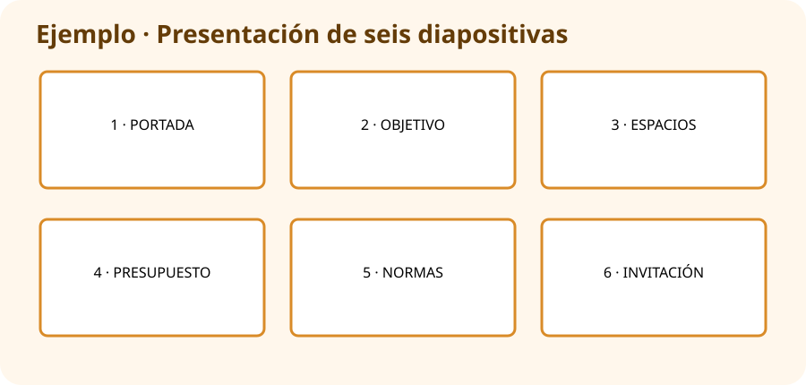

# PROY_UN4 · Presentamos la Feria Digital

## Continuamos el proyecto

Ya has creado la guía y el presupuesto. Ahora vas a reunir esa información en una presentación de **seis diapositivas** y explicarla durante unos tres minutos.

## Las seis diapositivas

1. Portada: `Feria Digital Responsable`, nombre y curso.
2. Objetivo: qué aprenderán los visitantes.
3. Espacios: los tres que explicaste en la guía de la UD02.
4. Presupuesto: total de **97 €** y gráfico de la UD03.
5. Normas: tres normas de participación.
6. Cierre: invitación y fuentes utilizadas.

!!! example "Ejemplo de diapositiva 4"
    Título `Un presupuesto posible`, gráfico grande en el centro y frase `Podemos preparar los materiales básicos por 97 €`. No copies toda la hoja de cálculo.

## Pasos

1. Abre **Menú de aplicaciones → Oficina → LibreOffice Impress**. Cierra el selector de plantillas. Pulsa **Archivo → Guardar como** y guarda `PROY_UN4_ApellidoNombre.odp` en `Documentos/FERIA_DIGITAL_TUNOMBRE/UD04_PRESENTACION`.
2. Crea cinco diapositivas más con **Diapositiva → Nueva diapositiva**. Comprueba que aparecen seis miniaturas. Para cada una elige **Título y contenido** en el panel lateral, salvo la portada.
3. Completa las diapositivas 1, 2 y 3 con el guion de arriba. Para recuperar el texto, abre `PROY_UN2_ApellidoNombre.odt` en Writer y copia solo las ideas principales.
4. Abre `PROY_UN3_ApellidoNombre.ods` en Calc. Haz clic en el borde exterior del gráfico → **Ctrl + C**. En la diapositiva 4 de Impress pulsa **Ctrl + V** y ajusta el tamaño desde una esquina. Añade `Total: 97 €`.
5. Completa la diapositiva 5 con tres normas de la guía. En la 6 escribe la invitación final y las fuentes: guía UD02, presupuesto UD03 y autoría o URL de las imágenes.
6. Selecciona el texto de contenido y usa al menos **24 puntos**. Conserva un tipo de letra y dos o tres colores. No tapes títulos ni pies con las imágenes.
7. Pulsa **F5**, recorre las seis diapositivas con flecha derecha y sal con **Esc**. Comprueba que el gráfico y sus rótulos se leen desde el fondo del aula.
8. Ensaya con un compañero y el cronómetro de **Menú de aplicaciones → Reloj → Cronómetro**. Si no está disponible, anotad la hora inicial y final. Ajusta tu explicación hasta durar entre 2:30 y 3:30 minutos.
9. Guarda con **Ctrl + S** y exporta con **Archivo → Exportar como → Exportar como PDF → Exportar**. Guarda `PROY_UN4_ApellidoNombre.pdf` junto al ODP. Abre el PDF y comprueba que contiene seis páginas.

## Entrega en Aules

Abre **Firefox → Aules → tu curso de Informática → UD04 → PROY_UN4**. Pulsa **Agregar entrega**, arrastra los archivos indicados abajo y pulsa **Guardar cambios**. Si aparece **Enviar tarea**, púlsalo y confirma. Comprueba que la entrega muestra tus archivos.

- `PROY_UN4_ApellidoNombre.odp`
- `PROY_UN4_ApellidoNombre.pdf`

Guárdalos también en `UD04_PRESENTACION`.

## Puntuación (10 puntos)

| Se comprobará | Puntos |
|---|---:|
| Contiene las seis diapositivas pedidas | 3 |
| Reutiliza correctamente guía, presupuesto y gráfico | 2 |
| Texto breve, imágenes útiles y diseño coherente | 2 |
| Exposición clara, fuentes y tiempo correcto | 3 |

!!! tip "Un proyecto que crece"
    No empiezas desde cero: estás mejorando y presentando materiales de las unidades anteriores.
