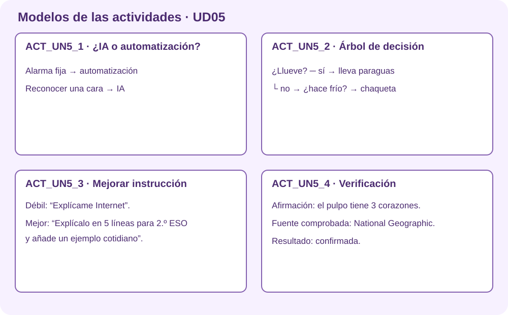

# Actividades · Fundamentos de inteligencia artificial

Estas actividades preparan el rincón `¿Esto es IA?` de la **Feria Digital Responsable**.

Trabaja en **LliureX**, con los menús en español. Lee **un paso cada vez** y comprueba el resultado antes de seguir. Las actividades de texto usan **LibreOffice Writer**; las hojas de cálculo, **Calc**; las presentaciones, **Impress**. Cada actividad concreta su herramienta y sus archivos de entrega.

| Código en Aules | Actividad |
|---|---|
| ACT_UN5_1 | Distinguir IA de automatización mediante casos |
| ACT_UN5_2 | Construir un árbol de decisión sencillo |
| ACT_UN5_3 | Comparar resultados al mejorar una instrucción |
| ACT_UN5_4 | Verificar tres afirmaciones generadas por IA |

## ACT_UN5_1 · Distinguir IA de automatización mediante casos

### ¿Qué vas a hacer?

Distinguir una automatización fija de un sistema que utiliza modelos entrenados con datos.

**Herramienta:** LibreOffice Writer.

**Dónde guardar:** `Documentos/FERIA_DIGITAL_TUNOMBRE/UD05_IA/ACTIVIDADES`. Si falta alguna carpeta, abre el **Gestor de archivos → Documentos**, entra en la carpeta anterior y créala con **clic derecho → Crear carpeta**. Cambia `TUNOMBRE` por tu nombre de aula.

!!! example "Ejemplo de resultado"
    `Calculadora: automatización`; `recomendador de vídeos: IA`; cada respuesta incluye una razón.

### Pasos

1. Abre **Menú de aplicaciones → Oficina → LibreOffice Writer**. Pulsa **Archivo → Nuevo → Documento de texto**.
2. Escribe `¿Es IA o una automatización?`. Pulsa **Tabla → Insertar tabla** y crea **3 columnas y 7 filas**. En los encabezados escribe `Caso`, `Clasificación` y `Razón`.
3. Usa estos seis casos: `alarma que suena a las 7:00`, `reconocimiento facial del móvil`, `calculadora que multiplica 25 por 8`, `recomendador de canciones que aprende de escuchas anteriores`, `puerta que se abre con un botón` y `filtro antispam entrenado con mensajes`. Copia cada caso en una fila de la primera columna.
4. En la segunda columna escribe `IA`, `Automatización sin IA` o `No tengo información suficiente`. En la tercera explica tu decisión en una frase.
5. Para decidir, pregunta si el caso usa un modelo entrenado con datos o si solo ejecuta una regla fija. Que algo sea automático no demuestra por sí solo que use IA.
6. Debajo de la tabla describe una entrada y una salida del recomendador. Ejemplo de entrada: canciones escuchadas; ejemplo de salida: una lista de sugerencias.
7. Compara tus seis decisiones con la explicación de clase y corrige las que necesites. Añade `He corregido… porque…` o `Mantengo mis respuestas porque…`. No necesitas abrir un chatbot.
8. Pulsa **Archivo → Guardar como**. Abre tu carpeta de esta unidad, escribe `ACT_UN5_1_ApellidoNombre_v01.odt` y conserva el formato OpenDocument correspondiente. Sustituye `ApellidoNombre` por tu apellido y nombre. Pulsa **Guardar** y, si pregunta el formato, elige **Usar formato OpenDocument**.
9. Para crear el PDF, pulsa **Archivo → Exportar como → Exportar como PDF → Exportar**, escribe el mismo nombre del editable y pulsa **Guardar**. Abre el PDF desde el Gestor de archivos y comprueba que no hay texto cortado.
10. Abre **Firefox**, entra en Aules con tu cuenta del centro y abre **Informática → UD05 → ACT_UN5_1**. Pulsa **Agregar entrega** (o **Editar entrega** si ya existe), arrastra los archivos pedidos al recuadro y pulsa **Guardar cambios**. Si aparece **Enviar tarea**, púlsalo y confirma. Comprueba que se ven tus archivos y que la entrega figura enviada.

### ¿Qué debes entregar?

- `ACT_UN5_1_ApellidoNombre_v01.odt`
- `ACT_UN5_1_ApellidoNombre_v01.pdf`
- Si utilizaste IA, indica la herramienta, para qué la usaste y cómo revisaste el resultado. Si no la usaste, indícalo sin inventar consultas.

### Antes de enviar

- [ ] Clasifico seis casos y justifico cada decisión.
- [ ] He abierto el archivo guardado y se ve completo.
- [ ] Los archivos tienen el nombre pedido y están adjuntos en Aules.
- [ ] No incluyo contraseñas, direcciones, teléfonos ni datos de otras personas.

## ACT_UN5_2 · Construir un árbol de decisión sencillo

### ¿Qué vas a hacer?

Dibujar un árbol de decisión con preguntas, ramas Sí/No y tres resultados.

**Herramienta:** LibreOffice Draw.

**Dónde guardar:** `Documentos/FERIA_DIGITAL_TUNOMBRE/UD05_IA/ACTIVIDADES`. Si falta alguna carpeta, abre el **Gestor de archivos → Documentos**, entra en la carpeta anterior y créala con **clic derecho → Crear carpeta**. Cambia `TUNOMBRE` por tu nombre de aula.

!!! example "Ejemplo de resultado"
    Árbol: `¿llueve?` → sí: paraguas; no → `¿hace frío?` → sí: chaqueta; no: salir sin abrigo.

### Pasos

1. Abre **Menú de aplicaciones → Oficina → LibreOffice Draw**. Pulsa **Archivo → Nuevo → Dibujo**.
2. Pulsa **Insertar → Forma → Formas básicas → Rombo**. Dibuja un rombo en la parte superior y haz doble clic dentro para escribir `¿Llueve?`.
3. Inserta un rectángulo debajo a la izquierda y escribe `Llevar paraguas`. Inserta otro rombo debajo a la derecha y escribe `¿Hace frío?`.
4. Bajo el segundo rombo dibuja dos rectángulos: a la izquierda `Llevar chaqueta` y a la derecha `Salir sin abrigo`.
5. En la barra **Dibujo** elige **Conector** y une las figuras: primer rombo con paraguas y con segundo rombo; segundo rombo con chaqueta y con salir sin abrigo. Si no ves la barra, activa **Ver → Barras de herramientas → Dibujo**.
6. Con **Insertar → Cuadro de texto**, escribe `Sí` junto a las ramas que llevan a paraguas y chaqueta; escribe `No` junto a las otras dos.
7. Prueba tres recorridos con el dedo: llueve → paraguas; no llueve y hace frío → chaqueta; no llueve y no hace frío → sin abrigo.
8. Añade un cuadro debajo: `Este árbol aplica reglas escritas por una persona; no aprende de ejemplos`. Comprueba que ninguna rama queda sin destino.
9. Pulsa **Archivo → Guardar como**. Abre tu carpeta de esta unidad, escribe `ACT_UN5_2_ApellidoNombre_v01.odg` y conserva el formato OpenDocument correspondiente. Sustituye `ApellidoNombre` por tu apellido y nombre. Pulsa **Guardar** y, si pregunta el formato, elige **Usar formato OpenDocument**.
10. Para crear el PDF, pulsa **Archivo → Exportar como → Exportar como PDF → Exportar**, escribe el mismo nombre del editable y pulsa **Guardar**. Abre el PDF desde el Gestor de archivos y comprueba que no hay texto cortado.
11. Abre **Firefox**, entra en Aules con tu cuenta del centro y abre **Informática → UD05 → ACT_UN5_2**. Pulsa **Agregar entrega** (o **Editar entrega** si ya existe), arrastra los archivos pedidos al recuadro y pulsa **Guardar cambios**. Si aparece **Enviar tarea**, púlsalo y confirma. Comprueba que se ven tus archivos y que la entrega figura enviada.

### ¿Qué debes entregar?

- `ACT_UN5_2_ApellidoNombre_v01.odg`
- `ACT_UN5_2_ApellidoNombre_v01.pdf`
- Si utilizaste IA, indica la herramienta, para qué la usaste y cómo revisaste el resultado. Si no la usaste, indícalo sin inventar consultas.

### Antes de enviar

- [ ] Hay dos preguntas, ramas Sí/No y tres resultados.
- [ ] He abierto el archivo guardado y se ve completo.
- [ ] Los archivos tienen el nombre pedido y están adjuntos en Aules.
- [ ] No incluyo contraseñas, direcciones, teléfonos ni datos de otras personas.

## ACT_UN5_3 · Comparar resultados al mejorar una instrucción

### ¿Qué vas a hacer?

Comparar dos instrucciones y explicar qué detalles hacen más útil una respuesta.

**Herramienta:** LibreOffice Writer y Firefox para abrir los materiales de Aules.

**Dónde guardar:** `Documentos/FERIA_DIGITAL_TUNOMBRE/UD05_IA/ACTIVIDADES`. Si falta alguna carpeta, abre el **Gestor de archivos → Documentos**, entra en la carpeta anterior y créala con **clic derecho → Crear carpeta**. Cambia `TUNOMBRE` por tu nombre de aula.

!!! example "Ejemplo de resultado"
    Petición 1: `Explícame Internet`. Petición 2: añade edad, 80 palabras, ejemplo y tres ideas clave; después se comparan.

### Pasos

1. Abre **Menú de aplicaciones → Oficina → LibreOffice Writer**. Pulsa **Archivo → Nuevo → Documento de texto**.
2. Escribe `Comparo dos instrucciones`. Crea los apartados `Intento 1`, `Intento 2` y `Comparación` aplicando el estilo **Título 1** desde el desplegable superior.
3. En Intento 1 copia la petición `Explícame Internet`. En Intento 2 copia `Explica qué es Internet para un alumno de 2.º ESO. Usa un máximo de 80 palabras, un ejemplo cotidiano y tres ideas clave`.
4. Abre **Firefox → Aules → curso de Informática → UD05 → ACT_UN5_3**. Si el profesor ha adjuntado o proyectado dos respuestas de IA, cópialas bajo su petición e indica el nombre de la herramienta y la fecha que figuren en el material.
5. Si no hay respuestas adjuntas, utiliza estas muestras didácticas. Muestra 1: «Internet es una red mundial de redes que permite intercambiar información. Podemos usarlo para consultar páginas, comunicarnos y compartir archivos.». Muestra 2: «Internet conecta redes de ordenadores para intercambiar información. Por ejemplo, en una videollamada tu dispositivo envía y recibe datos a través de esa red. Ideas clave: conecta redes; transmite datos; permite distintos servicios, como la web y las videollamadas.». Escribe expresamente `Muestras preparadas para practicar; no he consultado una IA`.
6. En Comparación crea una tabla de **3 columnas y 5 filas** con `Criterio`, `Intento 1`, `Intento 2`. Compara público destinatario, longitud, ejemplo y tres ideas clave. Escribe `Sí`, `No` o una observación concreta.
7. En cada intento selecciona únicamente la respuesta y pulsa **Herramientas → Contador de palabras**. Anota el número y comprueba si la segunda respeta el máximo de 80.
8. Debajo escribe dos diferencias y una conclusión. Comprueba con los apuntes de clase si la definición es correcta: una instrucción detallada no garantiza que todos los datos lo sean. Esta actividad puede hacerse sin cuenta de IA.
9. Pulsa **Archivo → Guardar como**. Abre tu carpeta de esta unidad, escribe `ACT_UN5_3_ApellidoNombre_v01.odt` y conserva el formato OpenDocument correspondiente. Sustituye `ApellidoNombre` por tu apellido y nombre. Pulsa **Guardar** y, si pregunta el formato, elige **Usar formato OpenDocument**.
10. Para crear el PDF, pulsa **Archivo → Exportar como → Exportar como PDF → Exportar**, escribe el mismo nombre del editable y pulsa **Guardar**. Abre el PDF desde el Gestor de archivos y comprueba que no hay texto cortado.
11. Abre **Firefox**, entra en Aules con tu cuenta del centro y abre **Informática → UD05 → ACT_UN5_3**. Pulsa **Agregar entrega** (o **Editar entrega** si ya existe), arrastra los archivos pedidos al recuadro y pulsa **Guardar cambios**. Si aparece **Enviar tarea**, púlsalo y confirma. Comprueba que se ven tus archivos y que la entrega figura enviada.

### ¿Qué debes entregar?

- `ACT_UN5_3_ApellidoNombre_v01.odt`
- `ACT_UN5_3_ApellidoNombre_v01.pdf`
- Si utilizaste IA, indica la herramienta, para qué la usaste y cómo revisaste el resultado. Si no la usaste, indícalo sin inventar consultas.

### Antes de enviar

- [ ] Conservo peticiones, respuestas, procedencia y una comparación.
- [ ] He abierto el archivo guardado y se ve completo.
- [ ] Los archivos tienen el nombre pedido y están adjuntos en Aules.
- [ ] No incluyo contraseñas, direcciones, teléfonos ni datos de otras personas.

## ACT_UN5_4 · Verificar tres afirmaciones generadas por IA

### ¿Qué vas a hacer?

Contrastar tres afirmaciones y registrar qué fuente permite confirmarlas o corregirlas.

**Herramienta:** Firefox y LibreOffice Writer.

**Dónde guardar:** `Documentos/FERIA_DIGITAL_TUNOMBRE/UD05_IA/ACTIVIDADES`. Si falta alguna carpeta, abre el **Gestor de archivos → Documentos**, entra en la carpeta anterior y créala con **clic derecho → Crear carpeta**. Cambia `TUNOMBRE` por tu nombre de aula.

!!! example "Ejemplo de resultado"
    Tabla `Afirmación | fuente consultada | confirmada / no confirmada | corrección` con tres filas.

### Pasos

1. Abre **Menú de aplicaciones → Oficina → LibreOffice Writer**. Pulsa **Archivo → Nuevo → Documento de texto**.
2. Escribe `Verifico tres afirmaciones`. Crea una tabla con **4 columnas y 4 filas**: `Afirmación`, `Fuente y URL`, `Veredicto` y `Corrección o explicación`.
3. Si ACT_UN5_4 de Aules contiene una respuesta generada y fechada, elige tres afirmaciones comprobables de ella. Si no hay material, usa estas afirmaciones de práctica: `La web e Internet son exactamente lo mismo`, `Tim Berners-Lee inventó la web en el CERN` y `Una contraseña larga y única ayuda a proteger una cuenta`. Señala cuál de los dos materiales estás usando; no atribuyas las muestras a una IA real.
4. Abre **Firefox**. Para las dos primeras busca `CERN birth of the web` y abre una página de `home.cern`. Para la tercera busca `INCIBE contraseñas seguras` y abre una página de `incibe.es`.
5. Lee el apartado que responde a cada afirmación. En la tabla anota título, organización y dirección de la página. Si ves una fecha, inclúyela; si no, escribe `sin fecha visible`.
6. Escribe un veredicto por fila: `Confirmada`, `Incorrecta` o `No confirmada`. Usa `No confirmada` cuando no encuentres pruebas suficientes, sin convertir esa ausencia en una demostración de falsedad.
7. Redacta con tus palabras la explicación o corrección de las tres frases. Debajo escribe una conclusión: `Antes de aceptar una respuesta debo…`.
8. Pulsa **Archivo → Guardar como**. Abre tu carpeta de esta unidad, escribe `ACT_UN5_4_ApellidoNombre_v01.odt` y conserva el formato OpenDocument correspondiente. Sustituye `ApellidoNombre` por tu apellido y nombre. Pulsa **Guardar** y, si pregunta el formato, elige **Usar formato OpenDocument**.
9. Para crear el PDF, pulsa **Archivo → Exportar como → Exportar como PDF → Exportar**, escribe el mismo nombre del editable y pulsa **Guardar**. Abre el PDF desde el Gestor de archivos y comprueba que no hay texto cortado.
10. Abre **Firefox**, entra en Aules con tu cuenta del centro y abre **Informática → UD05 → ACT_UN5_4**. Pulsa **Agregar entrega** (o **Editar entrega** si ya existe), arrastra los archivos pedidos al recuadro y pulsa **Guardar cambios**. Si aparece **Enviar tarea**, púlsalo y confirma. Comprueba que se ven tus archivos y que la entrega figura enviada.

### ¿Qué debes entregar?

- `ACT_UN5_4_ApellidoNombre_v01.odt`
- `ACT_UN5_4_ApellidoNombre_v01.pdf`
- Si utilizaste IA, indica la herramienta, para qué la usaste y cómo revisaste el resultado. Si no la usaste, indícalo sin inventar consultas.

### Antes de enviar

- [ ] Hay tres veredictos con sus fuentes y explicaciones.
- [ ] He abierto el archivo guardado y se ve completo.
- [ ] Los archivos tienen el nombre pedido y están adjuntos en Aules.
- [ ] No incluyo contraseñas, direcciones, teléfonos ni datos de otras personas.

!!! info "Mecanografía"
    Una vez por semana se dedicarán entre cinco y diez minutos a mecanografía en forma de juego. Abre **Firefox** y el enlace de mecanografía que figura en la sección de tu curso en Aules. Solo se entrega si el profesor lo indica.
