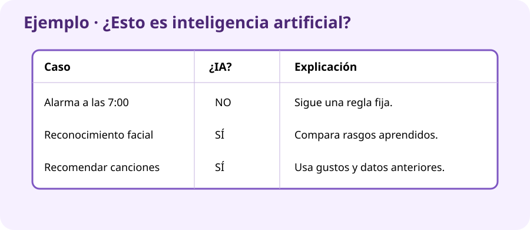

# PROY_UN5 · El rincón «¿Esto es IA?»

## Continuamos el proyecto

La Feria Digital tendrá un rincón para explicar la inteligencia artificial. Vas a crear una ficha con **seis ejemplos cotidianos** para que los visitantes intenten descubrir cuáles usan IA.

## Casos

1. Alarma programada a las 7:00.
2. Desbloqueo del móvil mediante la cara.
3. Calculadora que realiza `25 × 8`.
4. Aplicación que recomienda canciones.
5. Puerta que se abre al pulsar un botón.
6. Filtro que detecta correo basura.

!!! example "Ejemplo completo"
    **Alarma a las 7:00 → No es IA.** Sigue una hora programada y no aprende. Entrada: hora actual. Proceso: compararla con las 7:00. Resultado: sonar.

## Pasos

1. Abre **Menú de aplicaciones → Oficina → LibreOffice Writer → Archivo → Nuevo → Documento de texto**. Guarda `PROY_UN5_ApellidoNombre.odt` con **Archivo → Guardar como** en `Documentos/FERIA_DIGITAL_TUNOMBRE/UD05_IA`.
2. Escribe `¿Esto es inteligencia artificial?` y aplica el estilo **Título** desde el desplegable superior. Debajo explica en tres líneas la diferencia entre una regla fija y un modelo entrenado con datos.
3. Pulsa **Tabla → Insertar tabla**, elige **5 columnas y 7 filas** y escribe `Caso`, `¿IA?`, `Por qué`, `Entrada` y `Resultado` en la cabecera.
4. Copia los seis casos del enunciado, uno por fila. Completa las demás columnas. Cuando el caso no describa cómo funciona, puedes indicar `Depende` y explicar qué información falta.
5. Para el filtro de correo basura concreta si se trata de un modelo entrenado o de reglas fijas. Para las recomendaciones explica que utilizas el supuesto de un sistema entrenado con datos. No afirmes que toda aplicación de ese tipo utiliza necesariamente IA.
6. Debajo de la tabla pulsa **Insertar → Forma → Formas básicas → Rectángulo** y dibuja tres cajas. Escribe dentro `Entrada`, `Proceso` y `Resultado`. Usa **Insertar → Forma → Líneas** para unirlas con flechas.
7. Completa las cajas con un caso: `Escuchas anteriores → modelo que busca patrones → canciones recomendadas`. Mantén las cajas dentro de los márgenes.
8. Añade el apartado `Preguntas para visitantes` con tres preguntas breves y el apartado `Soluciones` con las respuestas justificadas. Usa **Título 1** para ambos apartados.
9. Comprueba las seis filas, la lectura del esquema y la correspondencia entre preguntas y soluciones. Pulsa **Ctrl + S** y después **Archivo → Exportar como → Exportar como PDF → Exportar**. Guarda `PROY_UN5_ApellidoNombre.pdf` y ábrelo para revisar el resultado.

## Entrega en Aules

Abre **Firefox → Aules → tu curso de Informática → UD05 → PROY_UN5**. Pulsa **Agregar entrega**, arrastra los archivos indicados abajo y pulsa **Guardar cambios**. Si aparece **Enviar tarea**, púlsalo y confirma. Comprueba que la entrega muestra tus archivos.

- `PROY_UN5_ApellidoNombre.odt`
- `PROY_UN5_ApellidoNombre.pdf`

Guárdalos también en `UD05_IA`.

## Puntuación (10 puntos)

| Se comprobará | Puntos |
|---|---:|
| Clasifica razonablemente los seis casos | 3 |
| Justifica las respuestas con claridad | 3 |
| Explica entrada, proceso y resultado | 2 |
| Incluye preguntas y entrega ODT + PDF | 2 |

!!! tip "Lo usarás después"
    En la siguiente unidad añadirás normas para que este rincón de IA sea también seguro y responsable.
