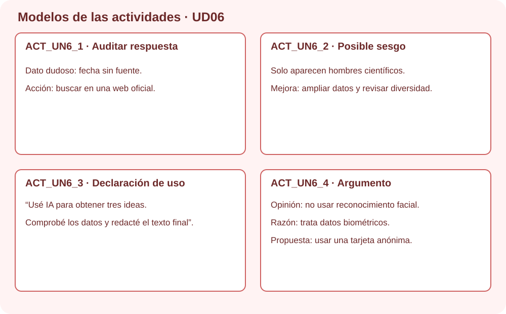

# Actividades · Aplicaciones y ética de la IA

Estas actividades te ayudarán a redactar las normas del rincón de IA de la **Feria Digital Responsable**.

Trabaja en **LliureX**, con los menús en español. Lee **un paso cada vez** y comprueba el resultado antes de seguir. Las actividades de texto usan **LibreOffice Writer**; las hojas de cálculo, **Calc**; las presentaciones, **Impress**. Cada actividad concreta su herramienta y sus archivos de entrega.

| Código en Aules | Actividad |
|---|---|
| ACT_UN6_1 | Auditar una respuesta con errores y fuentes falsas |
| ACT_UN6_2 | Analizar un caso de sesgo |
| ACT_UN6_3 | Redactar una declaración transparente de uso |
| ACT_UN6_4 | Debate documentado sobre una decisión ética |

## ACT_UN6_1 · Auditar una respuesta con errores y fuentes falsas

### ¿Qué vas a hacer?

Auditar un texto de práctica con errores y una referencia inventada.

**Herramienta:** Firefox y LibreOffice Writer.

**Dónde guardar:** `Documentos/FERIA_DIGITAL_TUNOMBRE/UD06_DECALOGO/ACTIVIDADES`. Si falta alguna carpeta, abre el **Gestor de archivos → Documentos**, entra en la carpeta anterior y créala con **clic derecho → Crear carpeta**. Cambia `TUNOMBRE` por tu nombre de aula.

!!! example "Ejemplo de resultado"
    Una afirmación marcada en rojo, enlace de comprobación y corrección escrita con palabras propias.

### Pasos

1. Abre **Menú de aplicaciones → Oficina → LibreOffice Writer**. Pulsa **Archivo → Nuevo → Documento de texto**.
2. Escribe `Auditoría de una respuesta`. Copia este texto bajo el rótulo `Texto ficticio preparado para detectar fallos`: `La web e Internet son lo mismo. La web fue inventada en 2005 por una empresa de telefonía. Una contraseña repetida es más segura porque se recuerda mejor. Fuente: Instituto Mundial de Internet, Informe universal de contraseñas, edición 2099.` No es una fuente real.
3. Crea una tabla de **4 columnas y 5 filas**: `Elemento`, `Qué compruebo`, `Prueba y URL` y `Corrección`.
4. Abre **Firefox** y busca en `home.cern` el origen de la web. Comprueba por separado la definición de web y la fecha y autoría de su creación. Completa dos filas.
5. Busca en `incibe.es` recomendaciones sobre contraseñas únicas. Completa la tercera fila con la recomendación que contradice o confirma el texto.
6. En la cuarta fila analiza la referencia: el año 2099 es futuro respecto al curso y el enunciado ya indica que es inventada. Escribe que no sirve como prueba. Si una búsqueda no encuentra una referencia, por sí sola no demuestra que sea falsa.
7. Selecciona en el texto inicial las partes erróneas y usa el botón **Color de fuente** para destacarlas. Añade al final un párrafo corregido con tus palabras y los enlaces utilizados.
8. Pulsa **Archivo → Guardar como**. Abre tu carpeta de esta unidad, escribe `ACT_UN6_1_ApellidoNombre_v01.odt` y conserva el formato OpenDocument correspondiente. Sustituye `ApellidoNombre` por tu apellido y nombre. Pulsa **Guardar** y, si pregunta el formato, elige **Usar formato OpenDocument**.
9. Para crear el PDF, pulsa **Archivo → Exportar como → Exportar como PDF → Exportar**, escribe el mismo nombre del editable y pulsa **Guardar**. Abre el PDF desde el Gestor de archivos y comprueba que no hay texto cortado.
10. Abre **Firefox**, entra en Aules con tu cuenta del centro y abre **Informática → UD06 → ACT_UN6_1**. Pulsa **Agregar entrega** (o **Editar entrega** si ya existe), arrastra los archivos pedidos al recuadro y pulsa **Guardar cambios**. Si aparece **Enviar tarea**, púlsalo y confirma. Comprueba que se ven tus archivos y que la entrega figura enviada.

### ¿Qué debes entregar?

- `ACT_UN6_1_ApellidoNombre_v01.odt`
- `ACT_UN6_1_ApellidoNombre_v01.pdf`
- Si utilizaste IA, indica la herramienta, para qué la usaste y cómo revisaste el resultado. Si no la usaste, indícalo sin inventar consultas.

### Antes de enviar

- [ ] Reviso tres afirmaciones y la referencia, con pruebas y correcciones.
- [ ] He abierto el archivo guardado y se ve completo.
- [ ] Los archivos tienen el nombre pedido y están adjuntos en Aules.
- [ ] No incluyo contraseñas, direcciones, teléfonos ni datos de otras personas.

## ACT_UN6_2 · Analizar un caso de sesgo

### ¿Qué vas a hacer?

Detectar una representación desigual en cuatro ejemplos y proponer cómo revisarla.

**Herramienta:** LibreOffice Writer.

**Dónde guardar:** `Documentos/FERIA_DIGITAL_TUNOMBRE/UD06_DECALOGO/ACTIVIDADES`. Si falta alguna carpeta, abre el **Gestor de archivos → Documentos**, entra en la carpeta anterior y créala con **clic derecho → Crear carpeta**. Cambia `TUNOMBRE` por tu nombre de aula.

!!! example "Ejemplo de resultado"
    Tabla de cuatro resultados con recuento y una conclusión que indique qué perfil se repite más.

### Pasos

1. Abre **Menú de aplicaciones → Oficina → LibreOffice Writer**. Pulsa **Archivo → Nuevo → Documento de texto**.
2. Escribe `¿Quién aparece como profesional de informática?`. Copia el caso: `Un sistema presenta cuatro ejemplos de personas que trabajan en informática: un hombre programador, un hombre técnico de redes, un hombre analista y una mujer diseñadora. Son ejemplos ficticios de clase, no resultados de una investigación`.
3. Crea una tabla de **3 columnas y 5 filas**: `Ejemplo`, `Perfil representado` y `Profesión`. Completa una fila por persona a partir del caso.
4. Debajo cuenta cuántas veces aparecen hombres y mujeres. Anota `3 de 4` y `1 de 4`, y calcula sus porcentajes: **75 %** y **25 %**.
5. Escribe quién aparece más, qué asociación podría reforzarse y qué personas quedan menos representadas. No deduzcas que una profesión pertenece a un sexo.
6. Añade una limitación: cuatro ejemplos no bastan para asegurar cómo funciona un sistema completo. Para investigarlo harían falta más muestras y conocer sus datos y condiciones.
7. Escribe una petición mejorada: `Presenta cuatro profesionales de informática con perfiles diversos y evita asociar tareas a un sexo`. Añade por qué una persona debe revisar también la nueva respuesta.
8. Pulsa **Archivo → Guardar como**. Abre tu carpeta de esta unidad, escribe `ACT_UN6_2_ApellidoNombre_v01.odt` y conserva el formato OpenDocument correspondiente. Sustituye `ApellidoNombre` por tu apellido y nombre. Pulsa **Guardar** y, si pregunta el formato, elige **Usar formato OpenDocument**.
9. Para crear el PDF, pulsa **Archivo → Exportar como → Exportar como PDF → Exportar**, escribe el mismo nombre del editable y pulsa **Guardar**. Abre el PDF desde el Gestor de archivos y comprueba que no hay texto cortado.
10. Abre **Firefox**, entra en Aules con tu cuenta del centro y abre **Informática → UD06 → ACT_UN6_2**. Pulsa **Agregar entrega** (o **Editar entrega** si ya existe), arrastra los archivos pedidos al recuadro y pulsa **Guardar cambios**. Si aparece **Enviar tarea**, púlsalo y confirma. Comprueba que se ven tus archivos y que la entrega figura enviada.

### ¿Qué debes entregar?

- `ACT_UN6_2_ApellidoNombre_v01.odt`
- `ACT_UN6_2_ApellidoNombre_v01.pdf`
- Si utilizaste IA, indica la herramienta, para qué la usaste y cómo revisaste el resultado. Si no la usaste, indícalo sin inventar consultas.

### Antes de enviar

- [ ] Incluyo el recuento, una limitación y una propuesta de mejora.
- [ ] He abierto el archivo guardado y se ve completo.
- [ ] Los archivos tienen el nombre pedido y están adjuntos en Aules.
- [ ] No incluyo contraseñas, direcciones, teléfonos ni datos de otras personas.

## ACT_UN6_3 · Redactar una declaración transparente de uso

### ¿Qué vas a hacer?

Redactar una declaración que explique de forma veraz si has usado IA y cómo revisaste el trabajo.

**Herramienta:** LibreOffice Writer.

**Dónde guardar:** `Documentos/FERIA_DIGITAL_TUNOMBRE/UD06_DECALOGO/ACTIVIDADES`. Si falta alguna carpeta, abre el **Gestor de archivos → Documentos**, entra en la carpeta anterior y créala con **clic derecho → Crear carpeta**. Cambia `TUNOMBRE` por tu nombre de aula.

!!! example "Ejemplo de resultado"
    `Usé una IA para proponer tres títulos. Elegí uno, lo reescribí y comprobé la ortografía`.

### Pasos

1. Abre **Menú de aplicaciones → Oficina → LibreOffice Writer**. Pulsa **Archivo → Nuevo → Documento de texto**.
2. Escribe `Declaración de uso de IA`. Elige un trabajo real que hayas realizado, por ejemplo **ACT_UN5_3**, y escribe su código.
3. Crea estos seis apartados: `Herramienta y fecha`, `Para qué`, `Instrucción`, `Qué utilicé`, `Qué cambié` y `Cómo lo comprobé`.
4. Si consultaste una IA, completa los seis apartados con lo que hiciste realmente. Copia tu instrucción sin incluir datos personales. Distingue la respuesta recibida de tu propia redacción.
5. Si no consultaste una IA, escribe `No he utilizado una herramienta de IA`. Si analizaste muestras del enunciado, añade `He trabajado con los ejemplos de clase`. Completa los apartados que procedan sin inventar una consulta.
6. En `Cómo lo comprobé` indica una comprobación concreta: fuente y URL, cálculo, prueba del programa o comparación con un apartado de los apuntes.
7. Redacta debajo una declaración final de cuatro a seis líneas reuniendo la información. Revísala para que coincida con el trabajo que entregaste.
8. Pulsa **Archivo → Guardar como**. Abre tu carpeta de esta unidad, escribe `ACT_UN6_3_ApellidoNombre_v01.odt` y conserva el formato OpenDocument correspondiente. Sustituye `ApellidoNombre` por tu apellido y nombre. Pulsa **Guardar** y, si pregunta el formato, elige **Usar formato OpenDocument**.
9. Para crear el PDF, pulsa **Archivo → Exportar como → Exportar como PDF → Exportar**, escribe el mismo nombre del editable y pulsa **Guardar**. Abre el PDF desde el Gestor de archivos y comprueba que no hay texto cortado.
10. Abre **Firefox**, entra en Aules con tu cuenta del centro y abre **Informática → UD06 → ACT_UN6_3**. Pulsa **Agregar entrega** (o **Editar entrega** si ya existe), arrastra los archivos pedidos al recuadro y pulsa **Guardar cambios**. Si aparece **Enviar tarea**, púlsalo y confirma. Comprueba que se ven tus archivos y que la entrega figura enviada.

### ¿Qué debes entregar?

- `ACT_UN6_3_ApellidoNombre_v01.odt`
- `ACT_UN6_3_ApellidoNombre_v01.pdf`
- Si utilizaste IA, indica la herramienta, para qué la usaste y cómo revisaste el resultado. Si no la usaste, indícalo sin inventar consultas.

### Antes de enviar

- [ ] La declaración describe mi proceso real y una comprobación concreta.
- [ ] He abierto el archivo guardado y se ve completo.
- [ ] Los archivos tienen el nombre pedido y están adjuntos en Aules.
- [ ] No incluyo contraseñas, direcciones, teléfonos ni datos de otras personas.

## ACT_UN6_4 · Debate documentado sobre una decisión ética

### ¿Qué vas a hacer?

Debatir una decisión sobre privacidad y recoger argumentos, riesgos y una propuesta del grupo.

**Herramienta:** LibreOffice Writer y Firefox.

**Dónde guardar:** `Documentos/FERIA_DIGITAL_TUNOMBRE/UD06_DECALOGO/ACTIVIDADES`. Si falta alguna carpeta, abre el **Gestor de archivos → Documentos**, entra en la carpeta anterior y créala con **clic derecho → Crear carpeta**. Cambia `TUNOMBRE` por tu nombre de aula.

!!! example "Ejemplo de resultado"
    Ficha: `decisión`, `beneficio`, `riesgo`, `persona afectada`, `medida de protección` y conclusión del grupo.

### Pasos

1. Abre **Menú de aplicaciones → Oficina → LibreOffice Writer**. Pulsa **Archivo → Nuevo → Documento de texto**.
2. Escribe `¿Usar reconocimiento facial en la feria?`. Copia el caso: `Una empresa propone identificar con cámaras a los visitantes para contar entradas y evitar duplicados. El grupo debe decidir si utiliza este sistema o cuenta visitas sin identificar a nadie`.
3. Crea una tabla de **5 columnas y 3 filas**: `Opción`, `Beneficio`, `Riesgo`, `Personas afectadas` y `Alternativa o protección`. Dedica una fila al reconocimiento facial y otra al recuento sin identificación.
4. En **Firefox** busca `AEPD reconocimiento facial datos biométricos` y abre un resultado de `aepd.es`. Anota título y URL, y una idea sobre los datos que se tratarían. Esta lectura sirve para argumentar el caso de clase.
5. En un grupo de tres, repartid los papeles de moderador, portavoz y secretario. Cada persona explica durante un minuto un beneficio o un riesgo; el secretario anota las razones en la tabla.
6. Debajo escribe `Decisión del grupo`, `Dos razones` y `Una objeción o duda`. Completad los tres apartados. Si no hay acuerdo, recoged las dos posturas.
7. Cada alumno escribe su conclusión personal de tres frases y una medida concreta para reducir la recogida de datos. Guarda tu propia copia, aunque la tabla se haya debatido en grupo.
8. Pulsa **Archivo → Guardar como**. Abre tu carpeta de esta unidad, escribe `ACT_UN6_4_ApellidoNombre_v01.odt` y conserva el formato OpenDocument correspondiente. Sustituye `ApellidoNombre` por tu apellido y nombre. Pulsa **Guardar** y, si pregunta el formato, elige **Usar formato OpenDocument**.
9. Para crear el PDF, pulsa **Archivo → Exportar como → Exportar como PDF → Exportar**, escribe el mismo nombre del editable y pulsa **Guardar**. Abre el PDF desde el Gestor de archivos y comprueba que no hay texto cortado.
10. Abre **Firefox**, entra en Aules con tu cuenta del centro y abre **Informática → UD06 → ACT_UN6_4**. Pulsa **Agregar entrega** (o **Editar entrega** si ya existe), arrastra los archivos pedidos al recuadro y pulsa **Guardar cambios**. Si aparece **Enviar tarea**, púlsalo y confirma. Comprueba que se ven tus archivos y que la entrega figura enviada.

### ¿Qué debes entregar?

- `ACT_UN6_4_ApellidoNombre_v01.odt`
- `ACT_UN6_4_ApellidoNombre_v01.pdf`
- Si utilizaste IA, indica la herramienta, para qué la usaste y cómo revisaste el resultado. Si no la usaste, indícalo sin inventar consultas.

### Antes de enviar

- [ ] Registro beneficios, riesgos, decisión del grupo y conclusión personal.
- [ ] He abierto el archivo guardado y se ve completo.
- [ ] Los archivos tienen el nombre pedido y están adjuntos en Aules.
- [ ] No incluyo contraseñas, direcciones, teléfonos ni datos de otras personas.

!!! info "Mecanografía"
    Una vez por semana se dedicarán entre cinco y diez minutos a mecanografía en forma de juego. Abre **Firefox** y el enlace de mecanografía que figura en la sección de tu curso en Aules. Solo se entrega si el profesor lo indica.
