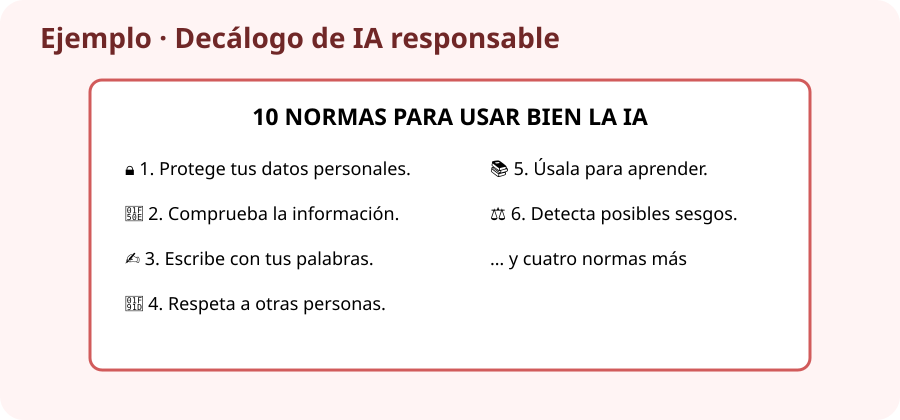

# PROY_UN6 · Decálogo de IA responsable

## Continuamos el proyecto

En la unidad anterior preparaste el rincón sobre IA. Ahora crearás el cartel de normas que se colocará junto a él durante la Feria Digital.

## ¿Qué tienes que hacer?

Crea un **decálogo visual de una página** con diez normas para utilizar la IA de forma segura, ética y útil.

!!! example "Ejemplo de tres normas"
    **1. Protege tus datos.** No escribas dirección, teléfono, contraseñas ni información privada.  
    **2. Comprueba antes de creer.** Contrasta los datos importantes en una fuente fiable.  
    **3. Di cómo la has usado.** Si la IA te ayudó, indícalo en el trabajo.

## Pasos

1. Abre **Menú de aplicaciones → Oficina → LibreOffice Writer → Archivo → Nuevo → Documento de texto**. Usa **Archivo → Guardar como** y guarda `PROY_UN6_ApellidoNombre.odt` en `Documentos/FERIA_DIGITAL_TUNOMBRE/UD06_DECALOGO`.
2. Escribe `10 normas para usar la IA de forma responsable`. Selecciona el título y usa **18 puntos** y **Negrita**.
3. Pulsa Intro. Escribe diez normas, cada una en un párrafo separado con un título breve y una explicación de una frase. Selecciónalas y pulsa **F12** para numerarlas.
4. Comprueba que tus diez normas incluyen al menos privacidad, verificación, autoría, respeto, sesgos y uso para aprender. Utiliza ejemplos concretos, como no introducir contraseñas o contrastar una fecha en una fuente fiable.
5. Selecciona el cuerpo y utiliza **12 puntos**. Destaca en negrita solo las palabras iniciales de cada norma. Evita usar párrafos vacíos para separar las normas.
6. Pulsa **Insertar → Forma → Formas básicas** y dibuja tres símbolos sencillos, por ejemplo un círculo con interrogación, una pantalla y una estrella. Son dibujos propios; no necesitas buscar imágenes. Colócalos sin tapar texto.
7. Pide a un compañero que lea y explique las normas 1, 5 y 10. Si interpreta algo distinto de lo que querías decir, reescribe esa norma con palabras más sencillas.
8. Comprueba en la barra inferior que el documento tiene una página. Si ocupa dos, acorta las explicaciones y reduce los dibujos, manteniendo el cuerpo a 12 puntos.
9. Pulsa **Ctrl + S** y **Archivo → Exportar como → Exportar como PDF → Exportar**. Guarda `PROY_UN6_ApellidoNombre.pdf` junto al ODT. Abre el PDF y comprueba las diez normas y los tres dibujos.

## Entrega en Aules

Abre **Firefox → Aules → tu curso de Informática → UD06 → PROY_UN6**. Pulsa **Agregar entrega**, arrastra los archivos indicados abajo y pulsa **Guardar cambios**. Si aparece **Enviar tarea**, púlsalo y confirma. Comprueba que la entrega muestra tus archivos.

- `PROY_UN6_ApellidoNombre.odt`;
- `PROY_UN6_ApellidoNombre.pdf`.

Guárdalos también en `UD06_DECALOGO`.

## Puntuación (10 puntos)

| Se comprobará | Puntos |
|---|---:|
| Diez normas concretas y correctas | 4 |
| Incluye los seis temas obligatorios | 2 |
| Diseño claro, legible y con apoyos visuales | 2 |
| Archivo revisado y bien entregado | 2 |

!!! warning "La IA no hace el trabajo por ti"
    Puede darte ideas, pero tú debes seleccionar, comprobar y redactar las normas con tus propias palabras.
