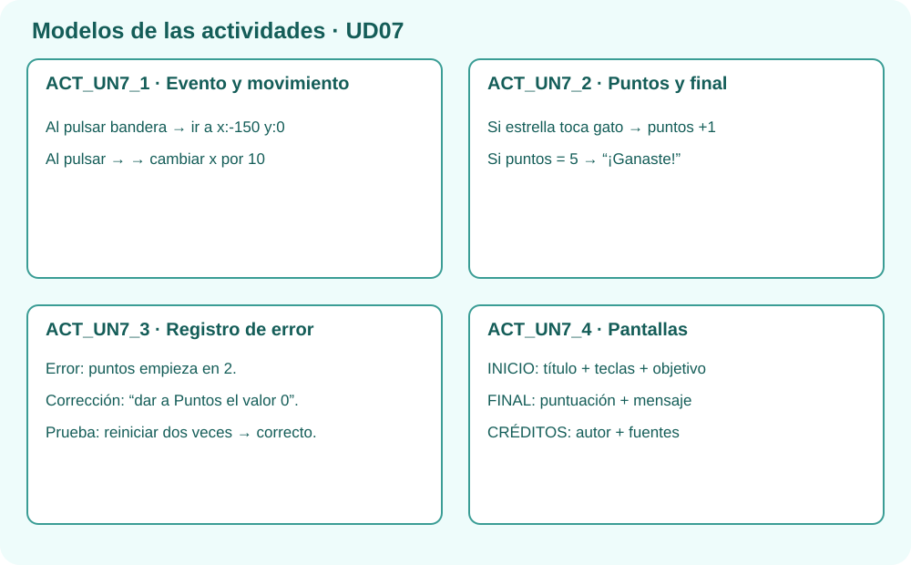

# Actividades · Programación por bloques con Scratch

Estas actividades construyen por partes el videojuego que presentarás al final de la **Feria Digital Responsable**.

Trabaja en **LliureX**, con los menús en español. Lee **un paso cada vez** y comprueba el resultado antes de seguir. Las actividades de texto usan **LibreOffice Writer**; las hojas de cálculo, **Calc**; las presentaciones, **Impress**. Cada actividad concreta su herramienta y sus archivos de entrega.

| Código en Aules | Actividad |
|---|---|
| ACT_UN7_1 | Animación controlada por eventos |
| ACT_UN7_2 | Minijuego con puntuación y condición de final |
| ACT_UN7_3 | Depurar un proyecto con errores preparados |
| ACT_UN7_4 | Diseñar pantalla inicial, instrucciones y créditos |

## ACT_UN7_1 · Animación controlada por eventos

### ¿Qué vas a hacer?

Crear una animación que se reinicie con la bandera y responda a la flecha derecha.

**Herramienta:** Scratch 3 en Firefox.

**Dónde guardar:** `Documentos/FERIA_DIGITAL_TUNOMBRE/UD07_VIDEOJUEGO/ACTIVIDADES`. Si falta alguna carpeta, abre el **Gestor de archivos → Documentos**, entra en la carpeta anterior y créala con **clic derecho → Crear carpeta**. Cambia `TUNOMBRE` por tu nombre de aula.

!!! example "Ejemplo de resultado"
    Al pulsar la bandera aparece el personaje; con flecha derecha avanza y cambia de disfraz.

### Pasos

1. Abre **Firefox** y entra en [el editor de Scratch](https://scratch.mit.edu/projects/editor/). No necesitas iniciar sesión para guardar en el ordenador. Si el idioma no es español, pulsa el icono del globo y elige **Español**.
2. Deja el gato inicial. En la zona inferior derecha pulsa **Elige un fondo** y selecciona un fondo de la biblioteca. Haz clic en la miniatura del gato para programarlo.
3. En la pestaña **Código**, abre la categoría amarilla **Eventos**. Arrastra `al hacer clic en la bandera verde` al área central.
4. En **Movimiento** arrastra `ir a x: -150 y: 0` y encájalo debajo del evento. En **Apariencia** encaja `mostrar` a continuación. Estos bloques forman un único programa de inicio.
5. Crea otro programa separado: **Eventos → al presionar tecla [espacio]**. Cambia el desplegable a **flecha derecha**.
6. Debajo encaja **Movimiento → cambiar x en 10** y **Apariencia → siguiente disfraz**. No los unas al programa de la bandera.
7. Pulsa la bandera: el gato debe volver a la izquierda. Pulsa cinco veces la flecha derecha: debe avanzar y cambiar de disfraz. Vuelve a pulsar la bandera y comprueba que regresa al inicio.
8. Si no responde, comprueba que los bloques están encajados y que programas el gato, no el escenario.
9. En Scratch pulsa **Archivo → Guardar en tu ordenador**. Guarda el archivo como `ACT_UN7_1_ApellidoNombre_v01.sb3` en la carpeta de esta unidad. Si se descarga en Descargas, muévelo desde el Gestor de archivos. Para comprobarlo, usa **Archivo → Cargar de tu ordenador** y abre esa copia.
10. Abre **Firefox**, entra en Aules con tu cuenta del centro y abre **Informática → UD07 → ACT_UN7_1**. Pulsa **Agregar entrega** (o **Editar entrega** si ya existe), arrastra los archivos pedidos al recuadro y pulsa **Guardar cambios**. Si aparece **Enviar tarea**, púlsalo y confirma. Comprueba que se ven tus archivos y que la entrega figura enviada.

### ¿Qué debes entregar?

- `ACT_UN7_1_ApellidoNombre_v01.sb3`
- Si utilizaste IA, indica la herramienta, para qué la usaste y cómo revisaste el resultado. Si no la usaste, indícalo sin inventar consultas.

### Antes de enviar

- [ ] La bandera reinicia y la flecha derecha mueve y anima al gato.
- [ ] He abierto el archivo guardado y se ve completo.
- [ ] Los archivos tienen el nombre pedido y están adjuntos en Aules.
- [ ] No incluyo contraseñas, direcciones, teléfonos ni datos de otras personas.

## ACT_UN7_2 · Minijuego con puntuación y condición de final

### ¿Qué vas a hacer?

Crear un minijuego donde recoger cinco estrellas aumenta los puntos y termina la partida.

**Herramienta:** Scratch 3 en Firefox.

**Dónde guardar:** `Documentos/FERIA_DIGITAL_TUNOMBRE/UD07_VIDEOJUEGO/ACTIVIDADES`. Si falta alguna carpeta, abre el **Gestor de archivos → Documentos**, entra en la carpeta anterior y créala con **clic derecho → Crear carpeta**. Cambia `TUNOMBRE` por tu nombre de aula.

!!! example "Ejemplo de resultado"
    El jugador recoge cinco estrellas, suma un punto por cada una y aparece `Has ganado` al llegar a 5.

### Pasos

1. Abre **Firefox** y entra en [el editor de Scratch](https://scratch.mit.edu/projects/editor/). Pulsa **Archivo → Cargar de tu ordenador** y elige el archivo `.sb3` de **ACT_UN7_1**. Si pide sustituir el proyecto actual, guarda primero cualquier cambio que quieras conservar.
2. Selecciona el gato. Añade un programa separado **Eventos → al presionar tecla [flecha izquierda]** con **Movimiento → cambiar x en -10** debajo. Así podrás moverlo en las dos direcciones.
3. Pulsa **Elige un objeto**, busca `Star` y añádelo. En su campo de nombre escribe `Estrella` y cambia su tamaño a `40`.
4. Selecciona Estrella. En **Variables → Crear una variable**, escribe `Puntos`, marca **Para todos los objetos** y acepta.
5. Para Estrella monta este programa: **Eventos → al hacer clic en bandera verde**; **Variables → dar a Puntos el valor 0**; **Apariencia → mostrar**; **Movimiento → ir a x: 100 y: 0**.
6. A continuación encaja **Control → repetir hasta que**. En su hueco coloca **Operadores → [ ] = [ ]**, arrastra el indicador naranja `Puntos` al primer hueco y escribe `5` en el segundo.
7. Dentro de repetir hasta que coloca **Control → si [ ] entonces** y en la condición **Sensores → ¿tocando [gato]?**. Elige el nombre real del gato en el desplegable.
8. Dentro de ese si encaja **Variables → cambiar Puntos en 1** y **Movimiento → ir a x: [número aleatorio entre -200 y 200] y: 0**. Después añade **Control → esperar hasta que [no (¿tocando gato?)]** usando el operador verde `no`; evita sumar varias veces en el mismo contacto.
9. Después del bucle, fuera de él, encaja **Apariencia → decir ¡Has ganado! durante 2 segundos** y **Control → detener todos**.
10. Prueba la partida: cada contacto debe sumar un punto, la estrella debe cambiar de lugar y con cinco puntos debe aparecer el mensaje. Pulsa la bandera otra vez: la puntuación debe volver a 0.
11. En Scratch pulsa **Archivo → Guardar en tu ordenador**. Guarda el archivo como `ACT_UN7_2_ApellidoNombre_v01.sb3` en la carpeta de esta unidad. Si se descarga en Descargas, muévelo desde el Gestor de archivos. Para comprobarlo, usa **Archivo → Cargar de tu ordenador** y abre esa copia.
12. Abre **Firefox**, entra en Aules con tu cuenta del centro y abre **Informática → UD07 → ACT_UN7_2**. Pulsa **Agregar entrega** (o **Editar entrega** si ya existe), arrastra los archivos pedidos al recuadro y pulsa **Guardar cambios**. Si aparece **Enviar tarea**, púlsalo y confirma. Comprueba que se ven tus archivos y que la entrega figura enviada.

### ¿Qué debes entregar?

- `ACT_UN7_2_ApellidoNombre_v01.sb3`
- Si utilizaste IA, indica la herramienta, para qué la usaste y cómo revisaste el resultado. Si no la usaste, indícalo sin inventar consultas.

### Antes de enviar

- [ ] Cada recogida suma uno; la partida acaba en cinco y puede reiniciarse.
- [ ] He abierto el archivo guardado y se ve completo.
- [ ] Los archivos tienen el nombre pedido y están adjuntos en Aules.
- [ ] No incluyo contraseñas, direcciones, teléfonos ni datos de otras personas.

## ACT_UN7_3 · Depurar un proyecto con errores preparados

### ¿Qué vas a hacer?

Provocar tres fallos controlados en una copia, identificarlos y documentar su corrección.

**Herramienta:** Scratch 3 en Firefox y LibreOffice Writer.

**Dónde guardar:** `Documentos/FERIA_DIGITAL_TUNOMBRE/UD07_VIDEOJUEGO/ACTIVIDADES`. Si falta alguna carpeta, abre el **Gestor de archivos → Documentos**, entra en la carpeta anterior y créala con **clic derecho → Crear carpeta**. Cambia `TUNOMBRE` por tu nombre de aula.

!!! example "Ejemplo de resultado"
    Tabla: `esperaba sumar 1 | sumó 2 | había dos bloques cambiar puntos | eliminé uno | ahora suma 1`.

### Pasos

1. Abre **Firefox** y entra en [el editor de Scratch](https://scratch.mit.edu/projects/editor/). Pulsa **Archivo → Cargar de tu ordenador** y elige el archivo `.sb3` de **ACT_UN7_2**. Si pide sustituir el proyecto actual, guarda primero cualquier cambio que quieras conservar.
2. Antes de tocar bloques, guarda una copia con **Archivo → Guardar en tu ordenador** y el nombre `ACT_UN7_3_ApellidoNombre_con_errores.sb3`. Conserva intacto el archivo de ACT_UN7_2.
3. En la copia prepara estos tres errores: en Estrella cambia `dar a Puntos el valor 0` por `dar a Puntos el valor 2`; cambia `cambiar Puntos en 1` por `cambiar Puntos en 2`; en el gato cambia el movimiento de flecha izquierda de `-10` a `10`.
4. Guarda otra vez la versión con errores y juega. Comprueba el inicio, la recogida y la flecha izquierda. No añadas más cambios mientras registras estos fallos.
5. Abre **Menú de aplicaciones → Oficina → LibreOffice Writer**. Pulsa **Archivo → Nuevo → Documento de texto**.
6. Escribe `Registro de depuración`. Crea una tabla de **4 columnas y 4 filas**: `Prueba`, `Esperaba`, `Ocurre` y `Corrección`. Completa una fila por cada fallo observado.
7. Vuelve a Scratch y corrige los tres valores: inicio `0`, incremento `1` y movimiento a la izquierda `-10`.
8. Repite las tres pruebas y una partida completa. En el registro añade una frase por prueba explicando el resultado después de corregir.
9. Guarda el registro como `ACT_UN7_3_ApellidoNombre_v01_registro.odt` y expórtalo a PDF con el mismo nombre. Guarda el juego corregido con el nombre final de esta actividad.
10. En Scratch pulsa **Archivo → Guardar en tu ordenador**. Guarda el archivo como `ACT_UN7_3_ApellidoNombre_v01.sb3` en la carpeta de esta unidad. Si se descarga en Descargas, muévelo desde el Gestor de archivos. Para comprobarlo, usa **Archivo → Cargar de tu ordenador** y abre esa copia.
11. Abre **Firefox**, entra en Aules con tu cuenta del centro y abre **Informática → UD07 → ACT_UN7_3**. Pulsa **Agregar entrega** (o **Editar entrega** si ya existe), arrastra los archivos pedidos al recuadro y pulsa **Guardar cambios**. Si aparece **Enviar tarea**, púlsalo y confirma. Comprueba que se ven tus archivos y que la entrega figura enviada.

### ¿Qué debes entregar?

- `ACT_UN7_3_ApellidoNombre_v01.sb3`
- `ACT_UN7_3_ApellidoNombre_v01_registro.pdf`
- Si utilizaste IA, indica la herramienta, para qué la usaste y cómo revisaste el resultado. Si no la usaste, indícalo sin inventar consultas.

### Antes de enviar

- [ ] Registro tres fallos y compruebo el juego corregido.
- [ ] He abierto el archivo guardado y se ve completo.
- [ ] Los archivos tienen el nombre pedido y están adjuntos en Aules.
- [ ] No incluyo contraseñas, direcciones, teléfonos ni datos de otras personas.

## ACT_UN7_4 · Diseñar pantalla inicial, instrucciones y créditos

### ¿Qué vas a hacer?

Añadir al juego una portada, instrucciones, inicio con espacio y una pantalla de créditos.

**Herramienta:** Scratch 3 en Firefox.

**Dónde guardar:** `Documentos/FERIA_DIGITAL_TUNOMBRE/UD07_VIDEOJUEGO/ACTIVIDADES`. Si falta alguna carpeta, abre el **Gestor de archivos → Documentos**, entra en la carpeta anterior y créala con **clic derecho → Crear carpeta**. Cambia `TUNOMBRE` por tu nombre de aula.

!!! example "Ejemplo de resultado"
    Pantalla inicial con título y botón; instrucciones con controles; pantalla final con autoría y recursos usados.

### Pasos

1. Abre **Firefox** y entra en [el editor de Scratch](https://scratch.mit.edu/projects/editor/). Pulsa **Archivo → Cargar de tu ordenador** y elige el archivo `.sb3` de **ACT_UN7_3**. Si pide sustituir el proyecto actual, guarda primero cualquier cambio que quieras conservar.
2. Selecciona el **Escenario** y abre **Fondos**. Conserva un fondo para jugar y llámalo `Juego`. Usa **Pintar** para crear otros dos: `Inicio` y `Creditos`.
3. En el fondo Inicio usa la herramienta **Texto** para escribir `Atrapa estrellas` y `Flechas: mover. Espacio: comenzar. Consigue 5 puntos`. En Creditos escribe el título, tu nombre de aula y `Personajes y fondos: biblioteca de Scratch` si son los que has usado.
4. En **Código del Escenario** crea **al hacer clic en bandera verde → cambiar fondo a Inicio**. En un programa separado coloca **al presionar tecla espacio → cambiar fondo a Juego → enviar mensaje [Comenzar]**; crea ese mensaje desde el desplegable.
5. En el gato sustituye el evento de bandera de su programa de colocación por **al recibir Comenzar**. Crea otro programa **al hacer clic en bandera → esconder**. El programa de Comenzar debe colocarlo en -150,0 y mostrarlo.
6. En el gato, dentro de cada evento de flecha, rodea el movimiento con **Control → si ([fondo número/nombre] = Juego) entonces**. El indicador del fondo se encuentra en **Apariencia**; elige **nombre de fondo**. Así no se juega desde la portada.
7. En Estrella sustituye el evento de bandera de su programa principal por **al recibir Comenzar**. Añade otro programa separado **al hacer clic en bandera → esconder**.
8. En Estrella, al final del programa, conserva el mensaje de victoria pero sustituye `detener todos` por **enviar mensaje [Fin] y esperar → detener todos**.
9. En el Escenario crea **al recibir Fin → cambiar fondo a Creditos**. En el gato y en Estrella crea, en cada objeto, **al recibir Fin → esconder**.
10. Prueba el recorrido completo: bandera → portada; espacio → juego con 0 puntos; cinco recogidas → créditos. Durante la partida pulsa la bandera para comprobar que vuelve a la portada.
11. Para evitar un segundo inicio mientras juegas, en el Escenario rodea el cambio a Juego y el envío de Comenzar con **si (nombre de fondo = Inicio) entonces**. Comprueba que pulsar espacio durante la partida no reinicia los puntos.
12. En Scratch pulsa **Archivo → Guardar en tu ordenador**. Guarda el archivo como `ACT_UN7_4_ApellidoNombre_v01.sb3` en la carpeta de esta unidad. Si se descarga en Descargas, muévelo desde el Gestor de archivos. Para comprobarlo, usa **Archivo → Cargar de tu ordenador** y abre esa copia.
13. Abre **Firefox**, entra en Aules con tu cuenta del centro y abre **Informática → UD07 → ACT_UN7_4**. Pulsa **Agregar entrega** (o **Editar entrega** si ya existe), arrastra los archivos pedidos al recuadro y pulsa **Guardar cambios**. Si aparece **Enviar tarea**, púlsalo y confirma. Comprueba que se ven tus archivos y que la entrega figura enviada.

### ¿Qué debes entregar?

- `ACT_UN7_4_ApellidoNombre_v01.sb3`
- Si utilizaste IA, indica la herramienta, para qué la usaste y cómo revisaste el resultado. Si no la usaste, indícalo sin inventar consultas.

### Antes de enviar

- [ ] Funcionan portada, instrucciones, juego y créditos.
- [ ] He abierto el archivo guardado y se ve completo.
- [ ] Los archivos tienen el nombre pedido y están adjuntos en Aules.
- [ ] No incluyo contraseñas, direcciones, teléfonos ni datos de otras personas.

!!! info "Mecanografía"
    Una vez por semana se dedicarán entre cinco y diez minutos a mecanografía en forma de juego. Abre **Firefox** y el enlace de mecanografía que figura en la sección de tu curso en Aules. Solo se entrega si el profesor lo indica.
