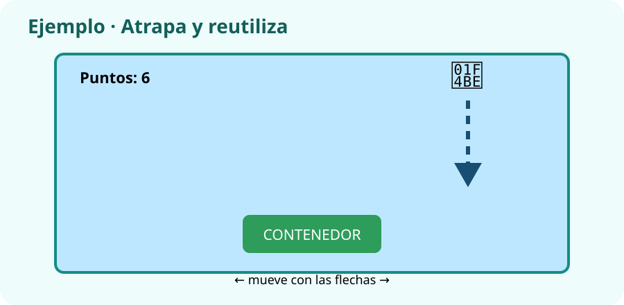

# PROY_UN7 · Juego final para la Feria Digital

## Terminamos el proyecto

La última parte de la Feria Digital será un videojuego realizado con **Scratch 3**. Los visitantes moverán un contenedor para atrapar objetos tecnológicos reutilizables.

## ¿Qué tienes que hacer?

Crea el juego `Atrapa y reutiliza`. El jugador mueve un contenedor con las flechas. Un objeto cae desde arriba; al atraparlo suma un punto y vuelve a aparecer. La partida termina al conseguir 10 puntos.

!!! example "Así debe funcionar"
    Al pulsar la bandera aparece `Usa las flechas y consigue 10 puntos`. El contenedor se mueve. Si atrapa una memoria USB, `Puntos` aumenta en 1. Al llegar a 10 aparece `¡La Feria Digital está preparada!` y el juego se detiene.

## Pasos

1. Abre **Firefox** y entra en [Scratch](https://scratch.mit.edu/projects/editor/). Elige **Español** en el globo de idioma. Trabajarás sin necesidad de crear una cuenta y guardarás un archivo `.sb3`.
2. Elimina el gato con el icono de papelera de su miniatura. Pulsa **Elige un objeto → Pintar**, dibuja un contenedor y llámalo `Contenedor`. Crea otro objeto dibujado con forma de memoria USB y nombre `USB`.
3. En el Escenario crea tres fondos desde la pestaña **Fondos → Pintar** y nómbralos `Inicio`, `Juego` y `Creditos`. En Inicio escribe `Atrapa y reutiliza. Flechas: mover. Espacio: comenzar`. En Creditos escribe título, nombre de aula y autoría de los dibujos.
4. En el Escenario crea `al hacer clic en bandera → cambiar fondo a Inicio`. En otro programa: `al presionar espacio → si <nombre de fondo = Inicio> entonces → cambiar fondo a Juego → enviar Comenzar`. Crea el mensaje desde el desplegable de **Eventos → enviar**.
5. En Contenedor crea `al hacer clic en bandera → esconder` y `al recibir Comenzar → ir a x: 0 y: -140 → mostrar`. Para cada flecha crea un evento de tecla con `si <nombre de fondo = Juego> entonces → cambiar x en 10` (derecha) o `cambiar x en -10` (izquierda). Si sale por el borde, añade un si para devolver x a 210 o -210.
6. En USB entra en **Variables → Crear una variable**, escribe `Puntos` y elige **Para todos los objetos**. Crea `al hacer clic en bandera → esconder` y otro programa `al recibir Comenzar → dar a Puntos el valor 0 → mostrar → ir a x: (número aleatorio entre -200 y 200) y: 170`.
7. A continuación, en USB añade **Control → repetir hasta que (Puntos = 10)**. Dentro encaja **Movimiento → cambiar y en -5** y **Control → esperar 0.03 segundos**. Usa el separador decimal que acepte el bloque; Scratch suele mostrar el punto.
8. Dentro del bucle añade `si <tocando Contenedor> entonces → cambiar Puntos en 1 → ir a x: (número aleatorio entre -200 y 200) y: 170`. Después añade otro si: `si <posición y < -170> entonces → ir a x: (número aleatorio entre -200 y 200) y: 170`. Encuentra las comparaciones en **Operadores** y el contacto en **Sensores**.
9. Después del bucle, fuera de él, coloca `decir ¡La Feria Digital está preparada! durante 2 segundos → enviar Fin y esperar → detener todos`. En Escenario crea `al recibir Fin → cambiar fondo a Creditos`. En Contenedor y USB crea `al recibir Fin → esconder`.
10. Prueba una recogida, una caída sin recoger, la victoria con 10 puntos y un reinicio con bandera y espacio. Los puntos deben volver a cero y los objetos deben ocultarse en portada y créditos.
11. Pulsa **Archivo → Guardar en tu ordenador**. Guarda `PROY_UN7_ApellidoNombre.sb3` en `Documentos/FERIA_DIGITAL_TUNOMBRE/UD07_VIDEOJUEGO`. Si cae en Descargas, muévelo con el Gestor de archivos. Vuelve a cargar esa copia para comprobarla.
12. Abre **Menú de aplicaciones → Captura de pantalla** y captura el juego durante una partida con Puntos visible. Guarda `PROY_UN7_ApellidoNombre.png` en la misma carpeta.

## Entrega en Aules

Abre **Firefox → Aules → tu curso de Informática → UD07 → PROY_UN7**. Pulsa **Agregar entrega**, arrastra los archivos indicados abajo y pulsa **Guardar cambios**. Si aparece **Enviar tarea**, púlsalo y confirma. Comprueba que la entrega muestra tus archivos.

- `PROY_UN7_ApellidoNombre.sb3`
- `PROY_UN7_ApellidoNombre.png`, captura con el juego y la puntuación visibles.

Guarda ambos en `UD07_VIDEOJUEGO`.

## Puntuación (10 puntos)

| Se comprobará | Puntos |
|---|---:|
| El contenedor se mueve y el objeto cae | 3 |
| La puntuación funciona | 3 |
| Tiene instrucciones, final y créditos | 2 |
| El proyecto abre, se juega y está bien entregado | 2 |

!!! success "Producto final"
    Tu carpeta contiene ya la organización, la guía, el presupuesto, la presentación, la ficha de IA, el decálogo y el videojuego de la Feria Digital Responsable.
